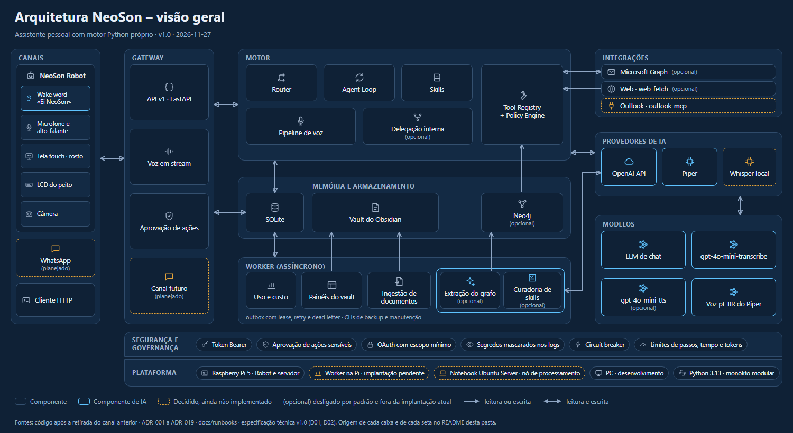

# NeoSon — Arquitetura em camadas v1.0

Visão de uma página do que o NeoSon tem hoje: componentes por camada, as trocas entre eles em
execução e onde cada parte roda.

## 0. Ponto de partida

- **Data:** 2026-11-27.
- **Código:** atualizado para a retirada do canal de mensagens anterior.
- **Fontes:** especificação técnica v1.0, seções 3, 3.1 e 4 (diagramas D01 e D02); ADR-001 a
  ADR-019; runbooks em [`docs/runbooks/`](../../runbooks/); [`.env.example`](../../../.env.example)
  para o que vem ligado ou desligado por padrão; inventário da Pi em
  [`docs/raspberry-pi-os.md`](../../raspberry-pi-os.md).
- **Relação com outros diagramas:** complementa os [diagramas Mermaid v1.0](../NeoSon_Diagramas_Mermaid_v1.0/).
  D01 (componentes) e D02 (implantação física) continuam como a proposta da especificação; este
  diagrama mostra o estado implementado. Nenhum arquivo é substituído.

## 1. Diagrama

Fonte: [`NeoSon_Arquitetura_Camadas.html`](NeoSon_Arquitetura_Camadas.html), HTML autocontido de
1500 × 820 px que abre em qualquer navegador e se ajusta à largura da janela. O PNG é a renderização
dele (Chrome sem janela, 1500 × 820).

**Convenções**

| Sinal | Significado |
|---|---|
| Caixa com borda azul | Componente de IA (modelos, provedores, wake word, extração do grafo e curadoria) |
| Borda tracejada âmbar | Decidido, ainda não implementado |
| "(opcional)" | Desligado por padrão no `.env.example` e fora da implantação atual |
| Seta simples | Leitura ou escrita num sentido, em execução |
| Seta de duas pontas | Leitura e escrita nos dois sentidos |

As setas representam trocas em tempo de execução, não dependência de import. Os limites de import
são do Import Linter ([ADR-006](../../decisions/ADR-006-Import-Boundaries.md)). Componentes da mesma
caixa não têm setas entre si: a ordem dentro do Agent Loop está na D04.

**Ícones:** todos genéricos, de linha, feitos para este diagrama. Nenhum logo oficial de terceiro
(OpenAI, Raspberry Pi, Obsidian, SQLite, Neo4j, Microsoft) foi usado.

## 2. Mapeamento por camada

Caminhos de código relativos a `apps/<app>/src/neoson_<app>/` ou
`packages/neoson-core/src/neoson_core/`.

### Canais

| Componente | O que faz | Origem |
|---|---|---|
| NeoSon Robot | Cliente na Raspberry Pi: escuta, fala, mostra o rosto e o painel de aprovação | robot `touch_voice.py`, `voice_client.py`; [robot-voice](../../runbooks/robot-voice.md), [rosto-do-robo](../../runbooks/rosto-do-robo.md) |
| Wake word «Ei NeoSon» | Detecta a frase na própria Pi; o áudio só vai ao servidor depois dela | robot `wake.py` (ONNX Runtime, extratores do openWakeWord v0.5.1 e modelo `ei_neoson.onnx`); [robot-voice](../../runbooks/robot-voice.md) |
| Microfone e alto-falante | Captura e reprodução pelo PipeWire | robot `pipewire.py`; [ADR-010](../../decisions/ADR-010-Voice.md) |
| Tela touch · rosto | Rosto animado, gestos e painel de aprovação | robot `face.py`, `touch_voice.py` |
| LCD do peito | CPU, temperatura, RAM e estado da escuta | robot `chest_display.py`; [display-do-peito](../../runbooks/display-do-peito.md) |
| Câmera | Imagem ao vivo na tela, aberta por gesto; não envia imagem ao servidor | [rosto-do-robo](../../runbooks/rosto-do-robo.md); [raspberry-pi-os](../../raspberry-pi-os.md) |
| WhatsApp (planejado) | Canal futuro de mensagens | Transporte e conexão ainda não definidos |
| Cliente HTTP | `neoson-robot "texto"` ou qualquer cliente com o token | robot `main.py`; seção "API" do README |

### Gateway

| Componente | O que faz | Origem |
|---|---|---|
| API v1 · FastAPI | Mensagens, sessões, execuções e consultas, com token Bearer | gateway `app.py`, `queries.py`; [ADR-005](../../decisions/ADR-005-API-Contracts.md) |
| Voz em stream | Recebe o áudio e devolve eventos NDJSON, com a fala frase a frase | gateway `voice.py`; [voice](../../runbooks/voice.md) |
| Aprovação de ações | Lista, aprova ou nega ações pendentes e retoma a execução | gateway `actions.py`; [action-approvals](../../runbooks/action-approvals.md) |
| Canal futuro (planejado) | Integração WhatsApp a especificar | Sem implementação |

### Motor

| Componente | O que faz | Origem |
|---|---|---|
| Router | Escolhe perfil e modelo pela política versionada | `routing/session_router.py`, `routing/policy_registry.py`; [ADR-009](../../decisions/ADR-009-Router-Lab.md), [routing-policies](../../runbooks/routing-policies.md) |
| Agent Loop | Monta o contexto (histórico, memória curada, skills), chama modelo e ferramentas dentro dos limites | `engine/loop.py`; [ADR-001](../../decisions/ADR-001-monolito-modular.md) |
| Skills | Versões aprovadas com permissões declaradas | `skills/registry.py`, `engine/skill_context.py`; [ADR-007](../../decisions/ADR-007-Skills.md) |
| Pipeline de voz | Transcreve, roda o Agent Loop e sintetiza a resposta frase a frase | `engine/voice.py` (`VoicePipeline`, `SentenceSplitter`); [ADR-010](../../decisions/ADR-010-Voice.md) |
| Delegação interna (opcional) | Análises sem ferramentas, com contexto e orçamento isolados | `engine/delegation.py`, `NEOSON_DELEGATION_ENABLED`; [ADR-013](../../decisions/ADR-013-Delegation.md) |
| Tool Registry + Policy Engine | Expõe as ferramentas e decide permitir, negar ou pedir aprovação | `tools/registry.py`, `engine/tools.py`; [ADR-003](../../decisions/ADR-003-Seguranca-Tools.md) |

### Memória e armazenamento

| Componente | O que faz | Origem |
|---|---|---|
| SQLite | Conversas, execuções, outbox, busca FTS5, memória curada, grafo (padrão), skills, políticas, ações e uso da fala | `infrastructure/db.py`, `infrastructure/migrations/`; [ADR-002](../../decisions/ADR-002-Persistencia.md) |
| Vault do Obsidian | Painéis e notas para leitura humana | `NEOSON_VAULT_PATH`; `telemetry/vault.py`, `memory/vault_export.py` |
| Neo4j (opcional) | Armazenamento alternativo do grafo | `memory/neo4j_graph.py`, `NEOSON_GRAPH_BACKEND=neo4j`; [ADR-017](../../decisions/ADR-017-Neo4j-Adapter.md) |

### Worker (assíncrono)

| Componente | O que faz | Origem |
|---|---|---|
| Uso e custo | Registra tokens e custo de cada execução | `telemetry/usage.py`; worker `main.py` (`build_handlers`) |
| Painéis do vault | Atualiza os painéis de métricas, memória, skills, roteamento e voz | `telemetry/vault.py`, `memory/vault_export.py`, `telemetry/router_vault.py` |
| Ingestão de documentos | Guarda o texto de documentos e gera notas no vault | `neoson-docs` (worker `docs_main.py`, `memory/documents.py`); [ADR-019](../../decisions/ADR-019-Document-Ingestion.md), [documentos](../../runbooks/documentos.md) |
| Extração do grafo (opcional) | Extrai fatos das memórias com o modelo; ficam pendentes até revisão | `neoson-graph` (worker `graph_main.py`, `memory/graph_extraction.py`), `NEOSON_MEMORY_GRAPH_ENABLED`; [ADR-015](../../decisions/ADR-015-Graph-Extraction.md) |
| Curadoria de skills (opcional) | Gera propostas de melhoria sem ativá-las | `neoson-curator` (worker `curation_main.py`, `skills/curation.py`), `NEOSON_CURATION_ENABLED`; [ADR-008](../../decisions/ADR-008-Propostas-Skills.md) |

Rodapé da caixa: a outbox com lease, retry e dead letter (`infrastructure/outbox.py`, worker
`worker.py`) e as CLIs `neoson-backup` e `neoson-maintenance`
([backup-restauracao](../../runbooks/backup-restauracao.md),
[janela-de-manutencao](../../runbooks/janela-de-manutencao.md)).

### Integrações

| Componente | O que faz | Origem |
|---|---|---|
| Microsoft Graph (opcional) | Lê a agenda e metadados do e-mail; cria eventos e rascunhos após aprovação | `tools/microsoft_read.py`, `tools/microsoft_write.py`, `NEOSON_PERSONAL_PROVIDER`, `NEOSON_PERSONAL_WRITE_PROVIDER`; [ADR-011](../../decisions/ADR-011-Personal-Integrations.md), [ADR-012](../../decisions/ADR-012-Personal-Writes.md) |
| Web · web_fetch (opcional) | Lê páginas com proteção de rede e aprovação fora dos domínios liberados | `tools/web_fetch.py`, `NEOSON_WEB_FETCH_ENABLED`; [ADR-018](../../decisions/ADR-018-Web-Fetch.md) |
| Outlook · outlook-mcp (decidido) | E-mail e calendário por um servidor MCP local | Decisão tomada; ADR e cliente MCP ainda não escritos |

### Provedores de IA

| Componente | O que faz | Origem |
|---|---|---|
| OpenAI API | Modelo de chat, transcrição e, opcionalmente, síntese | `providers/openai_provider.py`, `providers/openai_speech.py` |
| Piper | Síntese de voz local, com o processo mantido carregado | `providers/piper_speech.py`, `NEOSON_VOICE_TTS_PROVIDER=piper`; [voice](../../runbooks/voice.md) |
| Whisper local (decidido) | Transcrição local, a medir contra a da OpenAI | Decisão tomada; não implementado |

### Modelos

| Componente | Configuração |
|---|---|
| LLM de chat | `NEOSON_LLM_MODEL` (sem padrão versionado, definido na implantação) e perfil `NEOSON_PRIMARY_MODEL_PROFILE` |
| gpt-4o-mini-transcribe | `NEOSON_VOICE_STT_MODEL` |
| gpt-4o-mini-tts (opcional) | `NEOSON_VOICE_TTS_MODEL`; a implantação atual sintetiza com o Piper |
| Voz pt-BR do Piper | `NEOSON_PIPER_MODEL`, com efeito opcional em `NEOSON_VOICE_EFFECT` |

### Segurança e governança

| Controle | Origem |
|---|---|
| Token Bearer | `NEOSON_API_TOKEN`, obrigatório no gateway |
| Aprovação de ações sensíveis | `NEOSON_APPROVAL_MODE`, Policy Engine; [ADR-003](../../decisions/ADR-003-Seguranca-Tools.md), [action-approvals](../../runbooks/action-approvals.md) |
| OAuth com escopo mínimo | `tools/microsoft_oauth.py`; [ADR-011](../../decisions/ADR-011-Personal-Integrations.md), [ADR-012](../../decisions/ADR-012-Personal-Writes.md) |
| Segredos mascarados nos logs | `infrastructure/logs.py`; [logs-e-resiliencia](../../runbooks/logs-e-resiliencia.md) |
| Circuit breaker | `engine/circuit.py`, `NEOSON_LLM_CIRCUIT_*` |
| Limites de passos, tempo e tokens | `NEOSON_MAX_AGENT_STEPS`, `NEOSON_RUN_TIMEOUT_SECONDS`, limites de delegação, curadoria e extração |

### Plataforma

| Item | Estado |
|---|---|
| Raspberry Pi 5 · Robot e servidor | Robot (rosto com voz, wake word, LCD do peito) e, no mesmo aparelho, gateway, motor, SQLite e Piper, como serviços do usuário ([servicos-continuos](../../runbooks/servicos-continuos.md)) |
| Worker na Pi · implantação pendente | O worker existe e tem unidade de serviço, mas ainda não roda junto do gateway |
| Notebook Ubuntu Server · nó de processamento | Decidido: Pi como núcleo e notebook para processamento pesado (Whisper local, Neo4j). ADR ainda não escrito |
| PC · desenvolvimento | Desenvolvimento e testes |
| Python 3.13 · monólito modular | Workspace uv com pacotes e limites de import ([ADR-001](../../decisions/ADR-001-monolito-modular.md), [ADR-004](../../decisions/ADR-004-Packaging.md)) |

### Existem, mas ficaram fora do desenho

| Item | Onde está representado |
|---|---|
| Router Lab (dataset, benchmark e promoção de políticas, banco `router-lab.db`) | Router; [router-lab](../../runbooks/router-lab.md) |
| Sandbox de escrita pessoal (simula agenda e rascunhos para testar aprovações) | Tool Registry + Policy Engine; [personal-writes](../../runbooks/personal-writes.md) |
| Proteção contra repetição nas rotas de voz (opcional) | Voz em stream; `NEOSON_VOICE_REPLAY_PROTECTION_ENABLED` |
| Pasta de documentos originais e pasta de backups | Ingestão de documentos e rodapé do Worker |
| Biblioteca de skills em `skill_library/` e CLIs `neoson-skills` e `neoson-personal` | Skills; Microsoft Graph |
| Uso e custo da fala (`speech_usage`) | SQLite e Painéis do vault |

### Setas

| Seta | Nível | Troca em execução | Origem |
|---|---|---|---|
| Canais ↔ Gateway | camada ↔ camada | O Robot e o cliente HTTP enviam mensagens, voz e aprovações e recebem as respostas | robot `client.py`, `voice_client.py`; gateway `app.py` |
| Gateway ↔ Motor | camada ↔ camada | O gateway entrega a mensagem ou o áudio e recebe a resposta | gateway `composition.py` (`build_engine`, `build_voice`) |
| Gateway ↔ SQLite | camada ↔ componente | Consultas da API, ações pendentes, recibos de voz | gateway `queries.py`, `voice_replay.py`; `infrastructure/actions.py` |
| Motor ↔ SQLite | camada ↔ componente | Lê histórico, memória, skills e políticas; grava mensagens, execuções e eventos da outbox | `memory/session_store.py`, `memory/curated.py`, `skills/registry.py`, `infrastructure/outbox.py` |
| SQLite ↔ Worker | componente ↔ camada | O worker pega eventos da outbox por lease e grava efeitos, uso e dead letter | worker `worker.py`, `infrastructure/outbox.py` |
| Painéis do vault → Vault | componente → componente | Escreve os painéis | `telemetry/vault.py`, `memory/vault_export.py` |
| Ingestão de documentos → Vault | componente → componente | Escreve as notas dos documentos | `memory/documents.py` |
| Extração do grafo → Neo4j | componente → componente | Grava fatos quando o grafo usa Neo4j | worker `graph_main.py`, `memory/graph_backend.py` |
| Neo4j → Tool Registry | componente → componente | A ferramenta `memory_search` lê o grafo | `tools/memory_search.py` |
| Tool Registry ↔ Microsoft Graph | componente ↔ componente | Lê agenda e e-mail; cria eventos e rascunhos | `tools/microsoft_read.py`, `tools/microsoft_write.py` |
| Web → Tool Registry | componente → componente | A ferramenta `web_fetch` lê a página | `tools/web_fetch.py` |
| Motor ↔ Provedores de IA | camada ↔ camada | Agent Loop e delegação chamam o modelo; o pipeline de voz transcreve e sintetiza | `providers/openai_provider.py`, `providers/openai_speech.py`, `providers/piper_speech.py` |
| Extração e curadoria ↔ OpenAI API | componente ↔ componente | Chamam o modelo fora da conversa | worker `graph_main.py`, `curation_main.py` |
| Provedores ↔ Modelos | camada ↔ camada | O provedor executa o modelo configurado | `.env.example` |

## 3. Conformidade com a especificação v1.0 (D01/D02)

**Segue a especificação:** Gateway, Router, Agent Loop, Tool Registry com Policy Engine, Skills,
SQLite com outbox, worker assíncrono, vault do Obsidian com painéis (Metrics Exporter), curadoria de
skills (Learning Workers), Robot na Raspberry Pi e cliente HTTP.

**Diverge, e por quê:**

- **Context Builder** não é componente separado: o Agent Loop monta o contexto com histórico,
  memória curada e skills.
- **Subagent Manager** virou delegação interna sem ferramentas, opcional
  ([ADR-013](../../decisions/ADR-013-Delegation.md)).
- **Neo4j** é opcional; o grafo fica no SQLite por padrão
  ([ADR-014](../../decisions/ADR-014-Knowledge-Graph.md), [ADR-017](../../decisions/ADR-017-Neo4j-Adapter.md)).
- **"APIs externas e MCP"**: hoje são Microsoft Graph e `web_fetch`; o MCP está decidido
  (outlook-mcp), mas não implementado.
- **"Web e CLI"**: há cliente HTTP/CLI, mas não interface web.
- **Setas da D01** misturam dependência e troca de informação; aqui só entram trocas em execução.
- **D02** põe gateway, motor, SQLite e workers no notebook. Hoje gateway, motor e SQLite rodam na
  Raspberry Pi junto com o Robot, e o worker ainda não roda lá. O notebook (Ubuntu Server) está
  preparado para ser nó de processamento.
- **D02** cita Google e STT/TTS opcionais: Google não existe nem foi decidido; a transcrição é da
  OpenAI e a síntese é local, com o Piper.
- **D02** põe no PC um laboratório de fine-tuning; hoje o PC só é usado para desenvolvimento.

## 4. Pontos pendentes

- **Worker na Pi.** Sem ele, uso e custo, painéis do vault e extração do grafo não rodam na
  implantação atual, e os eventos ficam na outbox até um worker consumi-los
  ([servicos-continuos](../../runbooks/servicos-continuos.md)).
- **Notebook como nó de processamento.** Decidido, com ADR a escrever; Whisper local e Neo4j vão
  rodar nele.
- **outlook-mcp.** Decidido; faltam o ADR (inclusive o conflito entre o escopo `Mail.Send` do
  servidor e o [ADR-012](../../decisions/ADR-012-Personal-Writes.md)) e o cliente MCP.
- **WhatsApp.** Planejado para substituir o canal anterior; transporte e conexão ficam para uma entrega futura.
- **Logos oficiais.** O desenho usa ícones genéricos; para trocar, os arquivos oficiais precisam
  ser fornecidos.
