# NeoSon — Diagramas Mermaid v1.0

Todos os 18 diagramas reunidos para visualização. Abra o preview com `Ctrl+Shift+V`.

Os arquivos `.mmd` desta pasta continuam sendo a fonte: se alterar algum deles, atualize também o bloco correspondente aqui.

## Índice

- [D01 — Arquitetura lógica de componentes](#d01--arquitetura-lógica-de-componentes)
- [D02 — Distribuição física dos equipamentos](#d02--distribuição-física-dos-equipamentos)
- [D03 — Sequência de execução com ferramenta](#d03--sequência-de-execução-com-ferramenta)
- [D04 — Agent Loop e decisões](#d04--agent-loop-e-decisões)
- [D05 — Estados de execução](#d05--estados-de-execução)
- [D06 — Roteamento de modelos e cache](#d06--roteamento-de-modelos-e-cache)
- [D07 — Descoberta e execução de skills](#d07--descoberta-e-execução-de-skills)
- [D08 — Curadoria, testes e publicação de skills](#d08--curadoria-testes-e-publicação-de-skills)
- [D09 — Aprendizagem contínua assíncrona](#d09--aprendizagem-contínua-assíncrona)
- [D10 — Memória e recuperação de contexto](#d10--memória-e-recuperação-de-contexto)
- [D11 — Ingestão de documentos](#d11--ingestão-de-documentos)
- [D12 — Transactional outbox e worker](#d12--transactional-outbox-e-worker)
- [D13 — Pipeline de voz](#d13--pipeline-de-voz)
- [D14 — Métricas e dashboards no Obsidian](#d14--métricas-e-dashboards-no-obsidian)
- [D15 — Autorização de ferramentas](#d15--autorização-de-ferramentas)
- [D16 — Laboratório de avaliação do roteador](#d16--laboratório-de-avaliação-do-roteador)
- [D17 — CI/CD e publicação](#d17--cicd-e-publicação)
- [D18 — Primeiro incremento ponta a ponta](#d18--primeiro-incremento-ponta-a-ponta)

## D01 — Arquitetura lógica de componentes

Fonte: [D01.mmd](D01.mmd)

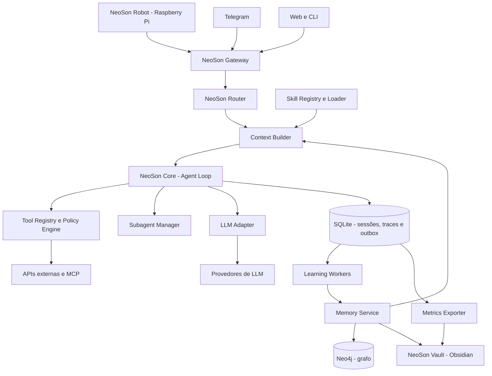

## D02 — Distribuição física dos equipamentos

Fonte: [D02.mmd](D02.mmd)

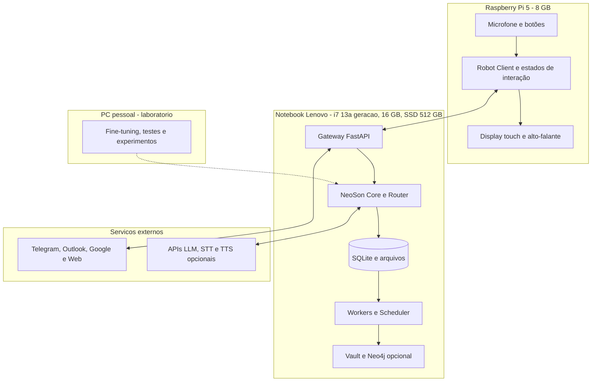

## D03 — Sequência de execução com ferramenta

Fonte: [D03.mmd](D03.mmd)

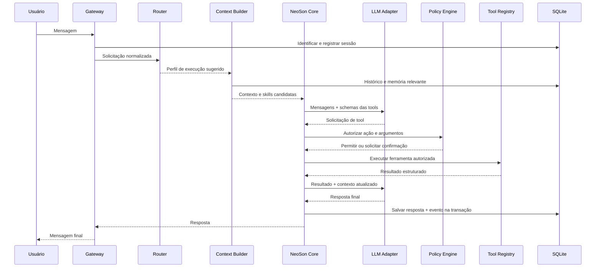

## D04 — Agent Loop e decisões

Fonte: [D04.mmd](D04.mmd)

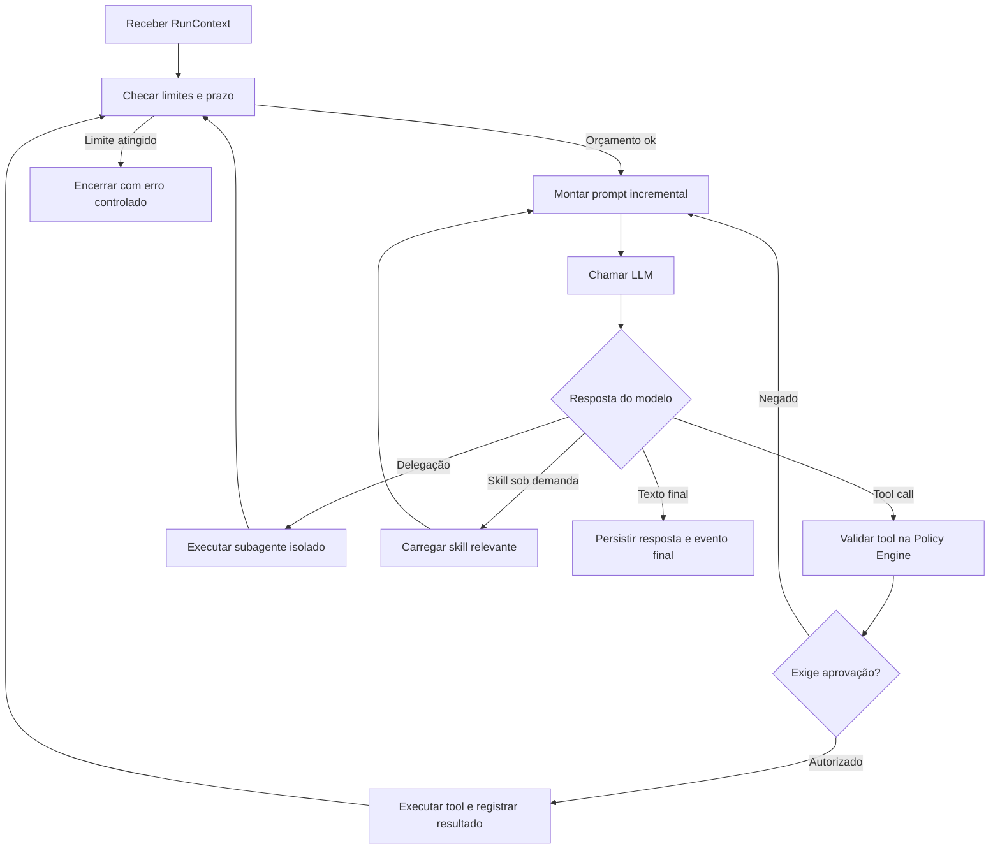

## D05 — Estados de execução

Fonte: [D05.mmd](D05.mmd)

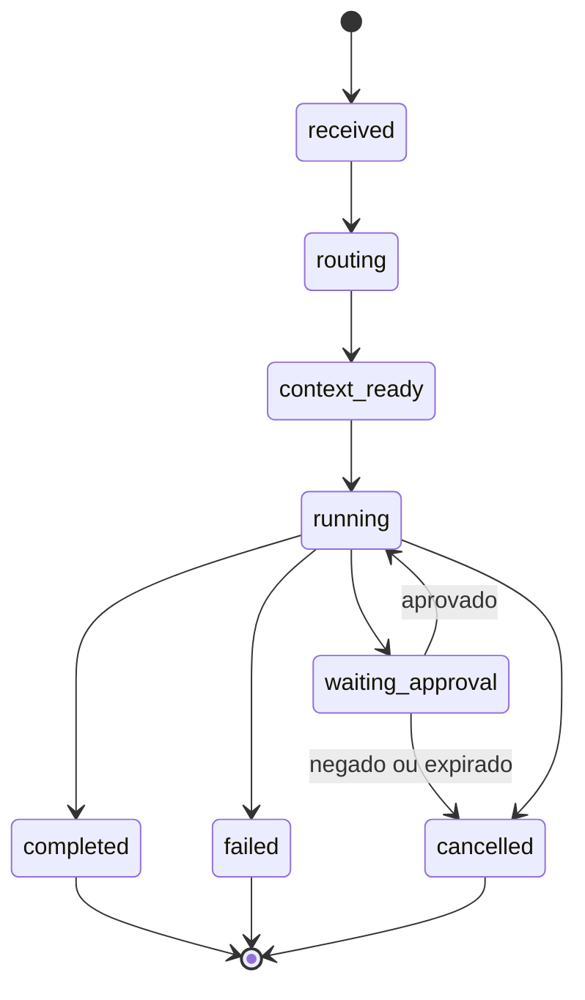

## D06 — Roteamento de modelos e cache

Fonte: [D06.mmd](D06.mmd)

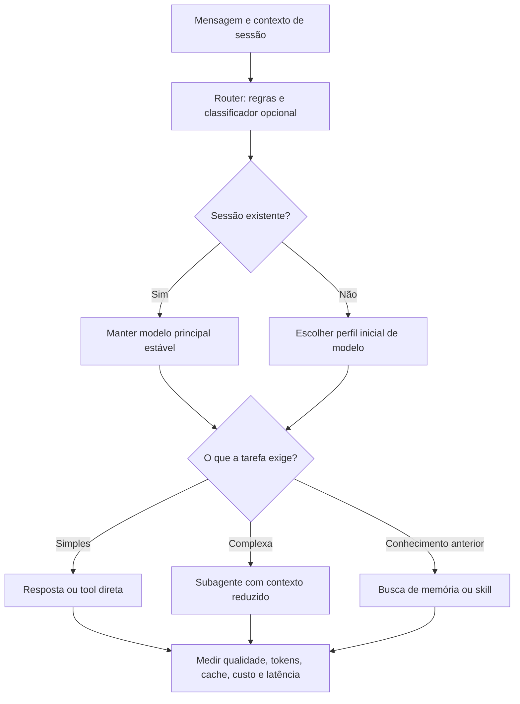

## D07 — Descoberta e execução de skills

Fonte: [D07.mmd](D07.mmd)

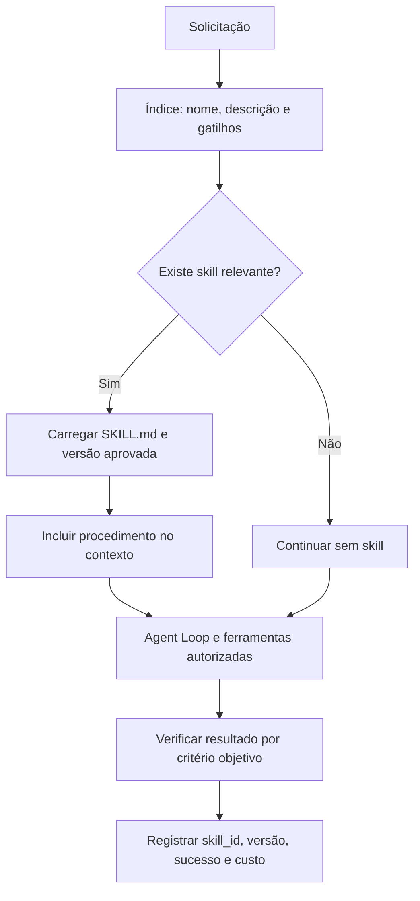

## D08 — Curadoria, testes e publicação de skills

Fonte: [D08.mmd](D08.mmd)

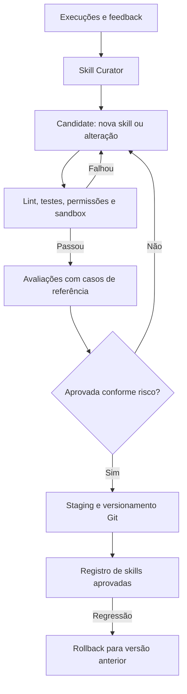

## D09 — Aprendizagem contínua assíncrona

Fonte: [D09.mmd](D09.mmd)

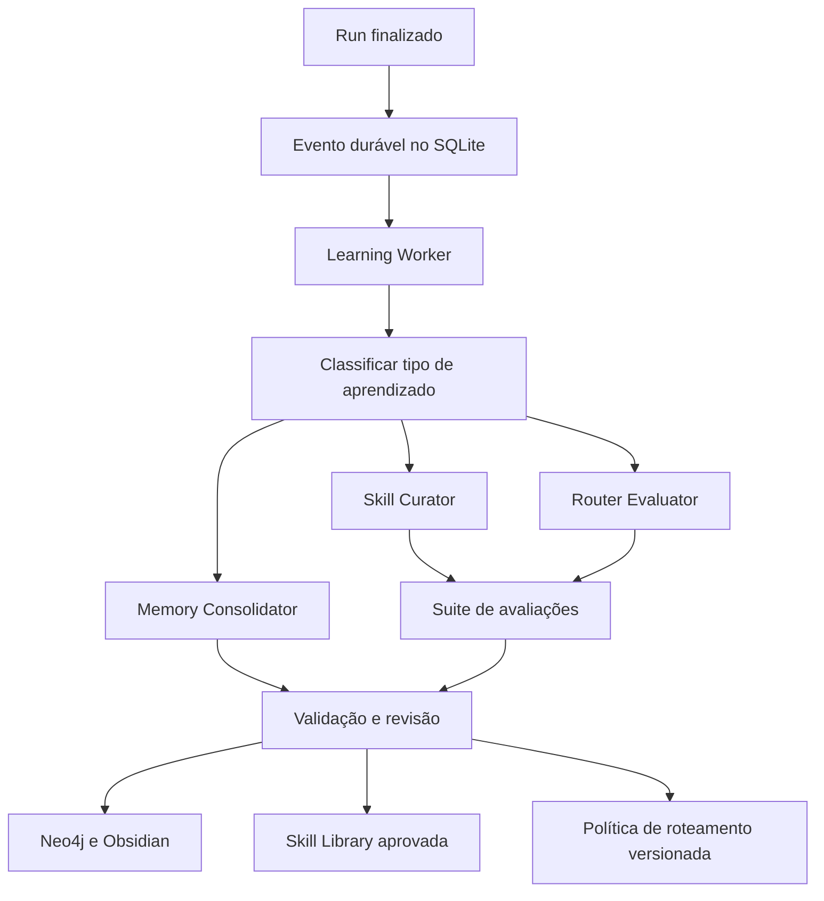

## D10 — Memória e recuperação de contexto

Fonte: [D10.mmd](D10.mmd)

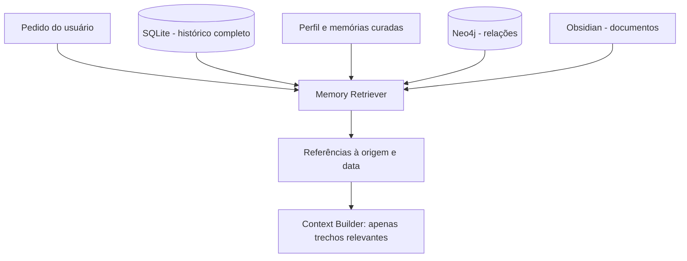

## D11 — Ingestão de documentos

Fonte: [D11.mmd](D11.mmd)

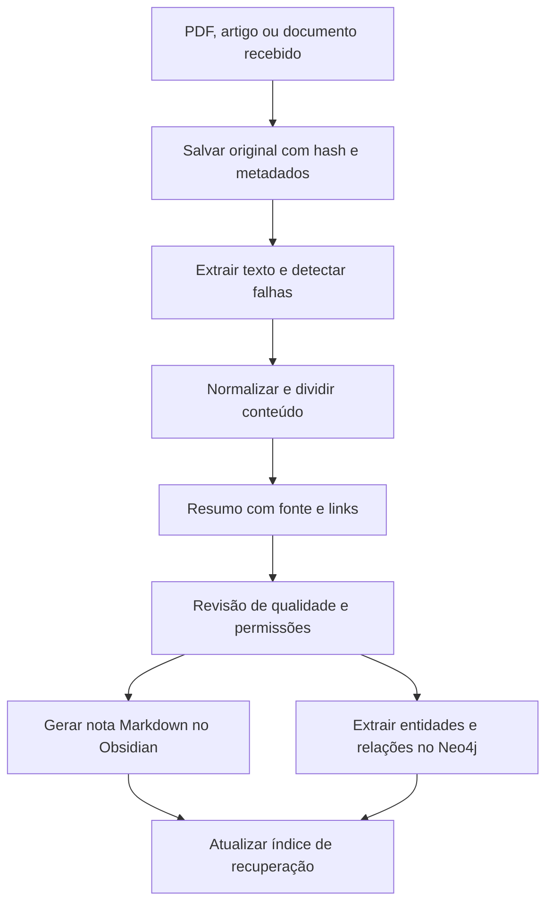

## D12 — Transactional outbox e worker

Fonte: [D12.mmd](D12.mmd)

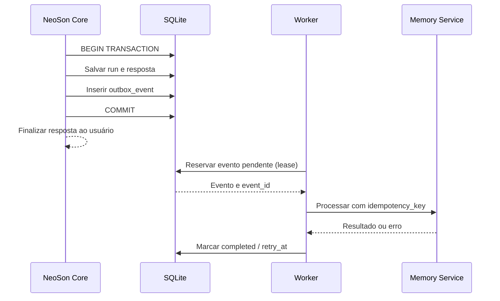

## D13 — Pipeline de voz

Fonte: [D13.mmd](D13.mmd)

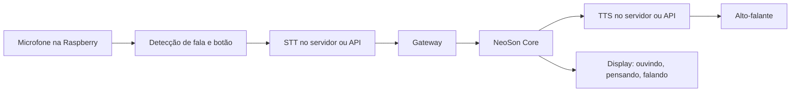

## D14 — Métricas e dashboards no Obsidian

Fonte: [D14.mmd](D14.mmd)

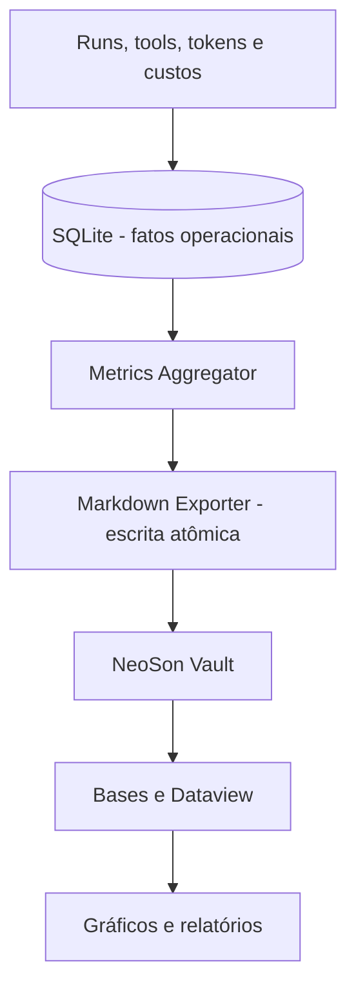

## D15 — Autorização de ferramentas

Fonte: [D15.mmd](D15.mmd)

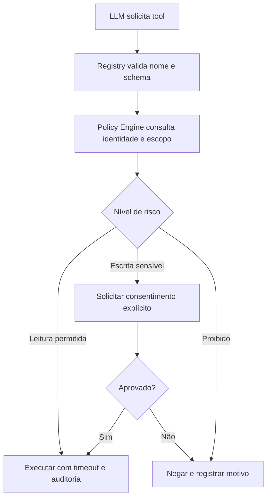

## D16 — Laboratório de avaliação do roteador

Fonte: [D16.mmd](D16.mmd)

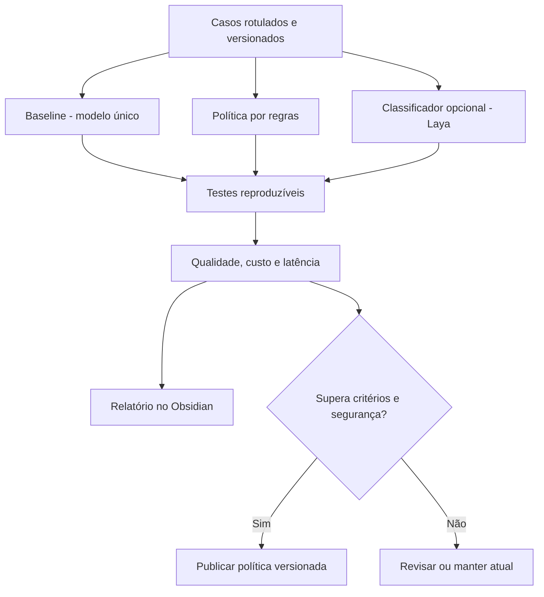

## D17 — CI/CD e publicação

Fonte: [D17.mmd](D17.mmd)

```mermaid
flowchart LR
    BRANCH[Feature branch]
    PR[Pull request]
    LINT[Ruff, mypy e testes]
    SECURITY[Scan de segredos e dependências]
    BUILD[Build e integração]
    APPROVE[Revisão e aprovação]
    DEPLOY[Deploy no notebook]
    SMOKE[Smoke tests e health checks]
    ROLLBACK[Rollback se falhar]
    BRANCH --> PR
    PR --> LINT
    LINT --> SECURITY
    SECURITY --> BUILD
    BUILD --> APPROVE
    APPROVE --> DEPLOY
    DEPLOY --> SMOKE
    SMOKE -->|Falha| ROLLBACK
```

## D18 — Primeiro incremento ponta a ponta

Fonte: [D18.mmd](D18.mmd)

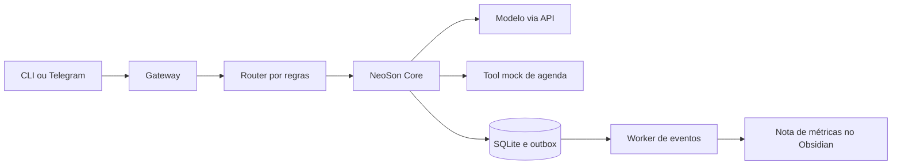

