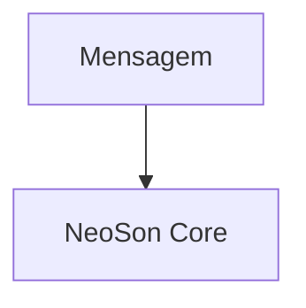

# NeoSon — Diagramas Mermaid v1.0

18 arquivos `.mmd` extraídos da especificação técnica v1.0. Os arquivos contêm o código Mermaid original e podem ser incluídos em notas Obsidian ou documentos Markdown com blocos `mermaid`.

| Arquivo | Diagrama |
|---|---|
| D01.mmd | Arquitetura lógica de componentes |
| D02.mmd | Distribuição física dos equipamentos |
| D03.mmd | Sequência de execução com ferramenta |
| D04.mmd | Agent Loop e decisões |
| D05.mmd | Estados de execução |
| D06.mmd | Roteamento de modelos e cache |
| D07.mmd | Descoberta e execução de skills |
| D08.mmd | Curadoria, testes e publicação de skills |
| D09.mmd | Aprendizagem contínua assíncrona |
| D10.mmd | Memória e recuperação de contexto |
| D11.mmd | Ingestão de documentos |
| D12.mmd | Transactional outbox e worker |
| D13.mmd | Pipeline de voz |
| D14.mmd | Métricas e dashboards no Obsidian |
| D15.mmd | Autorização de ferramentas |
| D16.mmd | Laboratório de avaliação do roteador |
| D17.mmd | CI/CD e publicação |
| D18.mmd | Primeiro incremento ponta a ponta |

Para visualizar todos de uma vez, abra [NeoSon_Diagramas.md](NeoSon_Diagramas.md) e use o preview (`Ctrl+Shift+V`).

Para utilizar em Markdown:

````markdown

````

Os desenhos podem evoluir independentemente da versão DOCX, mas a especificação Markdown é a fonte de verdade arquitetural.
