# NeoSon — Especificação técnica e plano de construção

**Versão:** 1.0  
**Data-base:** 19/10/2026  
**Status:** especificação inicial para orientar o desenvolvimento; não descreve um sistema já implementado.  
**Nome oficial:** **NeoSon**; pacote Python e diretórios: `neoson`; variáveis: `NEOSON_*`.

> **Decisão principal:** desenvolver um **motor de agentes próprio, pequeno e modular**, sem Hermes Agent como dependência. Utilizar os conceitos estudados — Agent Loop, tools, skills, memória persistente, subagentes, roteamento de modelos, telemetria e aprendizagem — com interfaces e responsabilidades controladas pelo projeto.

## 1. Resumo executivo

O NeoSon é um **assistente pessoal de IA com interface física**, acessível por voz na Raspberry Pi 5, Telegram, interface web e terminal. O núcleo de execução roda preferencialmente em um notebook servidor; a Raspberry atua como cliente de interação. O sistema acessa ferramentas autorizadas (agenda, e-mail, pesquisa, arquivos, MCP), mantém histórico e conhecimento persistente, utiliza skills reutilizáveis e acumula dados de qualidade e custo para evolução contínua.

O desenho possui **dois ciclos desacoplados**:

1. **Execução síncrona:** receber pedido → selecionar política e modelo → montar contexto → Agent Loop → ferramentas/skills/subagentes → resposta → registrar sessão e evento.
2. **Aprendizagem assíncrona:** consumir evento durável → extrair conhecimento, avaliar execução e propor skills/roteamento → validar → publicar mudanças aprovadas.

O **Obsidian é a interface de conhecimento e dashboards analíticos**, alimentada por arquivos Markdown e propriedades estruturadas. **SQLite é a fonte operacional**; **Neo4j é o grafo de conhecimento**, introduzido quando necessário. Obsidian não substitui o banco transacional nem o sistema de alertas operacionais.

### 1.1 Objetivos

- Conversa multimodal (voz e texto), acessível pela Pi e mensageria.
- Roteamento inteligente com medição de **qualidade, custo e latência**; intercambiável entre regras e classificador treinado.
- Execução segura de ferramentas, inclusive integração com agendas, e-mails e web.
- Aprendizagem procedural por **skills Markdown versionadas**, sem editar automaticamente o código do motor.
- Memória separada entre **histórico bruto, perfil do usuário, memória operacional do NeoSon, documentos e grafo**.
- Processamento assíncrono confiável, com **fila durável e reprocessamento idempotente**.
- Observabilidade e experimentos reproduzíveis; dashboard no Obsidian.
- Estudo de engenharia de software: testes, tipagem, CI/CD, documentação, ADRs, segurança e recuperação.

### 1.2 Fora do escopo do MVP

- Treinar modelos grandes localmente na Raspberry Pi.
- Clonar o conjunto completo de funcionalidades do Hermes Agent.
- Permitir que o agente altere e publique código de produção por conta própria.
- Conceder acesso irrestrito a e-mail, arquivos ou comandos de sistema.
- Introduzir Kafka, Redis, Kubernetes ou microsserviços sem necessidade comprovada.
- Garantir autonomia total ou confiabilidade perfeita das decisões de LLM.

### 1.3 Decisões confirmadas x propostas

| Assunto | Direção | Situação |
|---|---|---|
| Nome | NeoSon | Definido |
| Núcleo | Python próprio e enxuto; sem Hermes como dependência | Definido |
| Dispositivos | Raspberry Pi 5 (interface); notebook Lenovo (servidor); PC (laboratório) | Definido |
| LLMs | APIs de modelos; não rodar LLM grande na Raspberry | Definido |
| Memória | SQLite, Obsidian e evolução para Neo4j | Diretriz definida; detalhes propostos |
| Skills | `SKILL.md`, catálogo, versionamento, testes e curadoria | Definido conceitualmente |
| Roteador | Contrato próprio; regras primeiro e Laya opcional em laboratório | Proposto |
| Gateway | FastAPI e clientes Telegram/voz/web | Proposto |
| Fila | SQLite transactional outbox e workers Python | Proposto para MVP |
| Dashboards | Obsidian com Bases/Dataview/gráficos e exportador Markdown | Diretriz definida; plugins a validar |
| Aprovações | Escrita sensível e publicação de skills controladas | Requisito de segurança |

## 2. Princípios e requisitos de qualidade

**Arquitetura monolítica modular:** um repositório e serviços executáveis separados (`gateway`, `worker`, `robot`, `dashboard`), mas lógica de negócio encapsulada em pacotes. Componentes substituíveis por portas/adaptadores: provedores de LLM, storage, ferramentas, transcrição, voz, roteador e memória.

**Regras de implementação:**

- Sem lógica de negócio em handlers HTTP, Telegram ou GPIO.
- Todo acesso a rede, dados e APIs passa por adaptadores testáveis.
- LLM propõe ações; **Policy Engine valida** antes de executar.
- Uma execução tem `run_id`, `session_id`, limites e orçamento.
- Registro operacional é **durável antes** do processamento assíncrono.
- Não gravar segredos, tokens OAuth ou dados sensíveis brutos em traces e dashboards.
- Alterações de skills/roteador devem ser versionadas, testáveis e reversíveis.
- Toda métrica de economia precisa de **baseline explicitamente definido**.

### 2.1 Requisitos funcionais

| ID | Descrição | Prioridade |
|---|---|---|
| RF-01 | Receber mensagens via Telegram e CLI, depois voz na Raspberry | P0/P1 |
| RF-02 | Criar sessão, autenticar remetente e persistir mensagens | P0 |
| RF-03 | Executar Agent Loop com chamadas de ferramentas e limite de passos | P0 |
| RF-04 | Selecionar provedor/modelo por uma política desacoplada | P0 |
| RF-05 | Recuperar histórico e memória relevante antes de responder | P1 |
| RF-06 | Descobrir e carregar skills sob demanda | P1 |
| RF-07 | Executar subagentes com contexto independente e orçamento | P2 |
| RF-08 | Publicar eventos duráveis de execução, falha e feedback | P0 |
| RF-09 | Extrair memória e criar propostas de skills assincronamente | P2 |
| RF-10 | Validar e aprovar/publicar versões de skills | P2 |
| RF-11 | Exportar métricas e relatórios Markdown para o Obsidian | P1 |
| RF-12 | Avaliar roteamento em cenários rotulados e comparar baseline | P2 |
| RF-13 | Integrar agenda, e-mail e web com permissões explícitas | P1/P2 |
| RF-14 | Voz, expressão no display e estados do robô | P2 |

### 2.2 Requisitos não funcionais e metas iniciais

| Área | Objetivo de engenharia | Como verificar |
|---|---|---|
| Segurança | Controle de acesso por identidade e ferramenta; confirmações | Testes de autorização e de prompt injection |
| Resiliência | Reiniciar worker sem perder evento já confirmado no banco | Teste de desligamento durante job |
| Qualidade | Rotas e skills comparadas a conjunto de casos rotulados | Avaliações automatizadas e revisão humana |
| Observabilidade | Cada chamada recebe trace, tokens, tempo, erro e custo estimado | Testes e inspeção dos registros |
| Manutenibilidade | Tipagem estática, lint, testes unitários e contratos claros | Pipeline CI |
| Performance | Definir SLO só após medições reais no hardware | Teste de carga no notebook/Pi |
| Privacidade | Minimizar dados enviados ao modelo e exportados ao vault | Revisão de logs e políticas de retenção |
| Recuperação | Backup testado de SQLite, vault e configuração | Exercício de restauração |

## 3. Visão lógica completa

**D01 — Arquitetura de componentes.** Setas representam dependências e trocas de informações, não ordem obrigatória de execução.

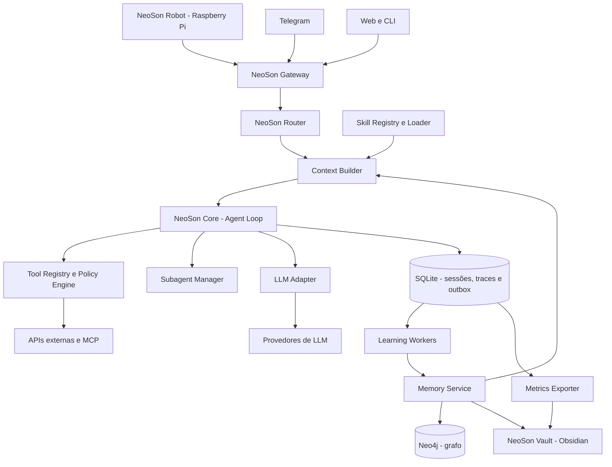

### 3.1 Componentes e fronteiras

| Serviço/módulo | Faz | Não faz |
|---|---|---|
| Gateway | autenticar, normalizar mensagem, entregar/responder | escolher ferramentas ou gerar resposta |
| Router | recomendar perfil de execução/modelo, registrar confiança | substituir permissões ou forçar chamadas |
| Context Builder | reunir sessão, memória, resumos e skills | alterar memória bruta |
| NeoSon Core | controlar estados e passos do agente | conter SDKs de fornecedores e persistência concreta |
| LLM Adapter | formatar mensagens, suportar tool-calling, observar tokens | validar permissões de ações |
| Tool Registry | descobrir schemas, executar adaptadores | permitir automaticamente qualquer operação |
| Policy Engine | aprovar/negar/solicitar consentimento | confiar na instrução retornada pela LLM |
| Subagent Manager | isolar tarefa, contexto, ferramentas e orçamento | ganhar privilégio extra por delegação |
| Memory Service | recuperar, consolidar, registrar origem/contradição | usar uma única nota como verdade universal |
| Learning Workers | gerar propostas e métricas | publicar mudanças de alto risco sem aprovação |
| Metrics Exporter | exportar relatórios agregados e notas estruturadas | substituir traces ou banco operacional |

## 4. Implantação física e comunicação

**D02 — Onde os componentes executam.** A máquina pessoal pode ficar desligada sem interromper o funcionamento do NeoSon.

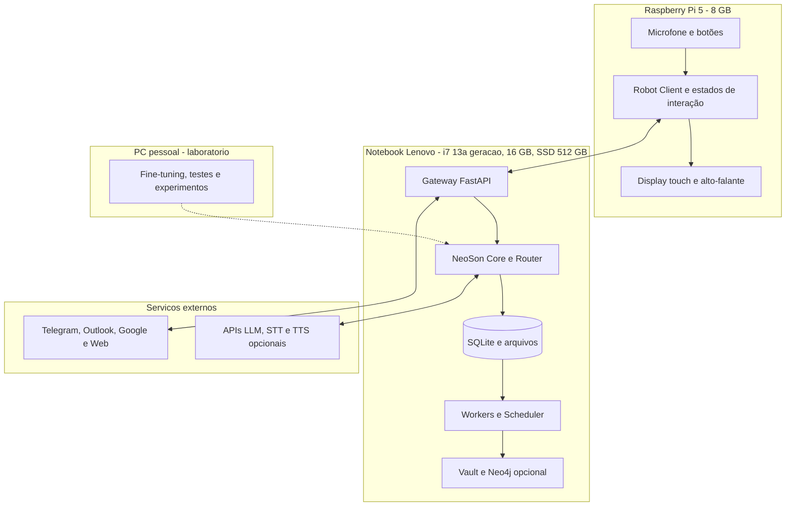

**Regra de infraestrutura:** primeiro executar SQLite, gateway, core e worker no notebook; deixar Neo4j desligado/fora do MVP até haver um caso de uso mensurável. O vault gravável precisa residir no notebook (ou em armazenamento continuamente acessível) e ser sincronizado de maneira controlada com o PC. A Raspberry envia áudio/comandos e reproduz mídia; reconhecimento e síntese podem ser locais no notebook ou APIs, avaliados depois.

## 5. Fluxo de conversação e motor

**D03 — Sequência de um pedido que necessita de ferramenta.**

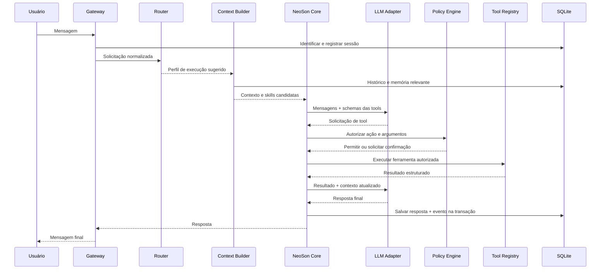

**D04 — Máquina de decisão do Agent Loop.**

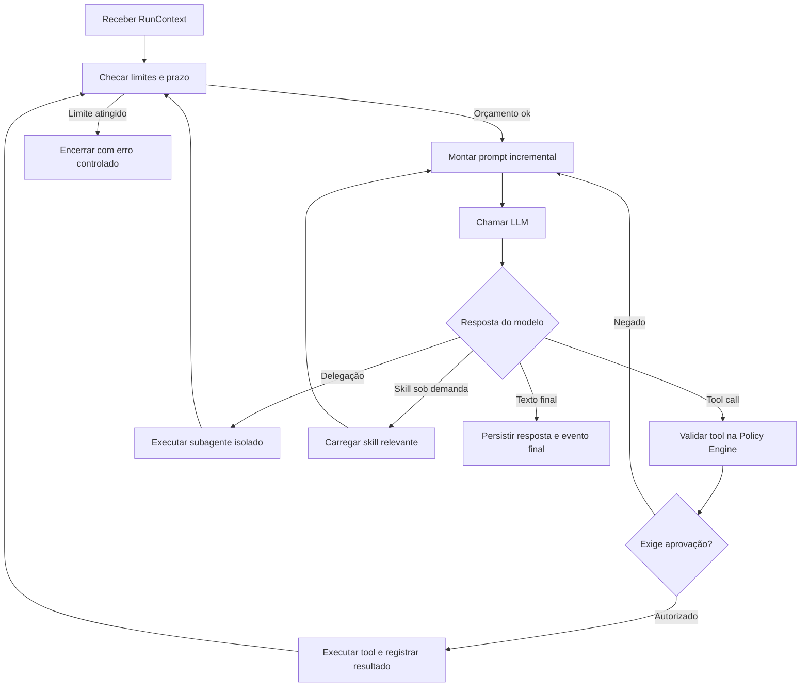

### 5.1 Regras da execução

- Cada execução (`run`) pertence a uma sessão, recebe `run_id`, `trace_id`, orçamento de tokens/custo, timeout e `max_steps` configurável.
- A LLM **propõe** a próxima ação; o Loop **controla** a repetição; a Policy Engine **autoriza** a execução.
- Ferramentas devolvem resultados com estado (`ok`, `error`, `requires_approval`), dados estruturados e resumo seguro para a LLM.
- Falhas transitórias usam retentativa limitada; falhas definitivas são registradas e informadas ao usuário.
- Subagentes herdam permissões iguais ou mais restritivas; nunca mais amplas.
- Histórico operacional completo fica no SQLite, não no prompt inteiro.
- Sessões com contexto longo devem usar resumo e recuperação sob demanda com referências à fonte.

### 5.2 Estados de execução

**D05 — Estados simplificados.**

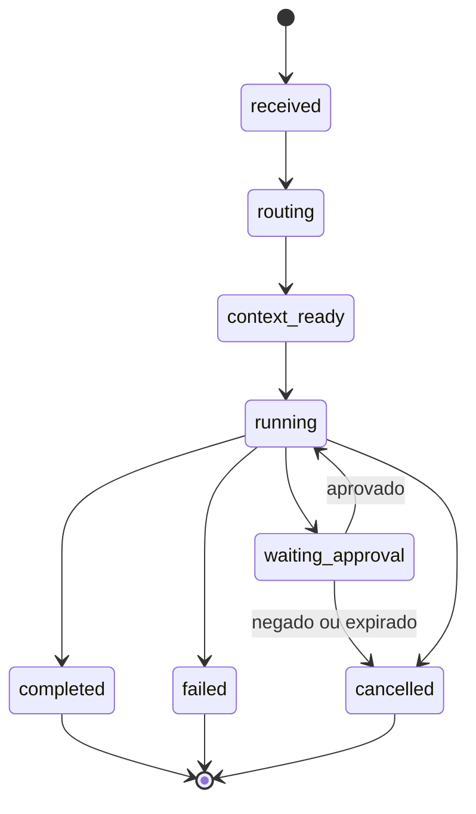

## 6. Roteamento de modelos e preservação de cache

O roteador é um **contrato substituível**. Inicialmente, regras Python; em experimentos, Laya ou classificador próprio; na produção, somente políticas validadas. O custo de classificação também entra no custo total.

**D06 — Seleção de modelo e estratégia de execução.**

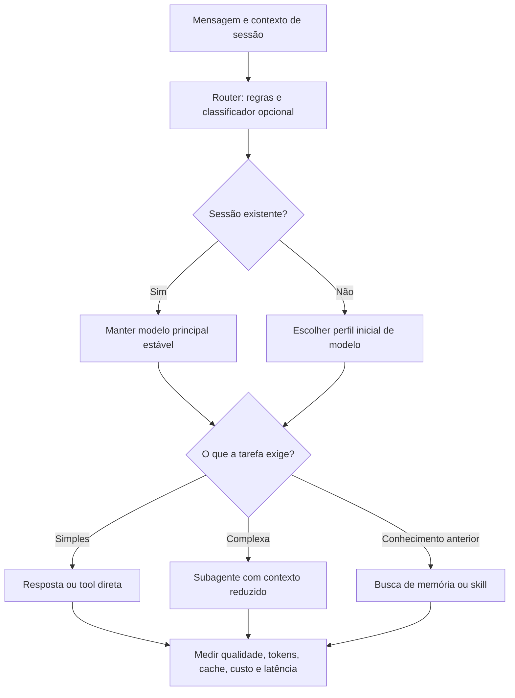

**Política para preservar cache:** manter preferencialmente o modelo principal fixo em uma sessão; usar subagentes/modelos auxiliares em tarefas complexas com contexto menor. A mudança de modelo principal não apaga o histórico, mas pode invalidar o cache do provedor; compactar antes da troca reduz volume, mas não preserva o cache anterior. A decisão de escalonamento considera custo da tarefa completa, não apenas preço por token.

**Contrato sugerido do roteador:**

```python
@dataclass(frozen=True)
class RouteDecision:
    intent: str
    complexity: Literal["low", "medium", "high"]
    execution_mode: Literal["direct", "retrieve", "delegate"]
    primary_model_profile: str
    confidence: float
    policy_version: str
    rationale_code: str  # código explicável, sem chain-of-thought
```

No início da sessão, a decisão seleciona `primary_model_profile`. Durante a sessão, decide-se se vale delegar, recuperar ou usar tool **sem trocar o modelo principal a cada turno**. Queda de provedor pode acionar fallback explícito com registro de impacto em cache/qualidade.

## 7. Skills: catálogo, execução e governança

Uma skill é um procedimento versionado, com `SKILL.md`, metadados, exemplos, permissões declaradas e testes. Skills podem carregar scripts auxiliares, mas **não recebem automaticamente acesso irrestrito ao sistema**.

**D07 — Localização e execução de skills.**

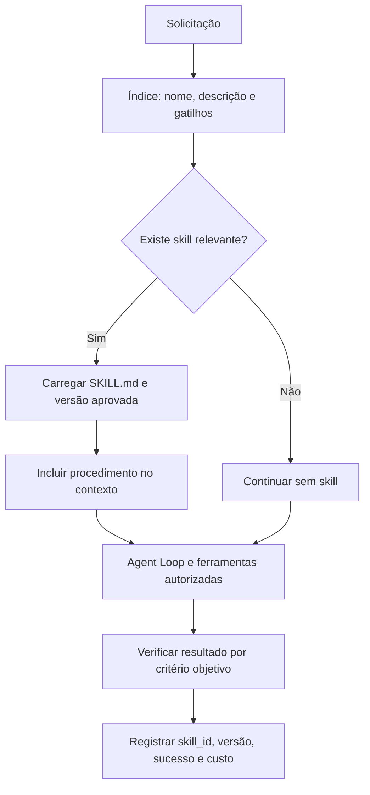

### 7.1 Estrutura de uma skill

```text
skill_library/
└── organizar_artigo/
    ├── SKILL.md
    ├── metadata.yaml
    ├── examples/
    │   └── entrada_exemplo.md
    ├── scripts/
    │   └── extrair_texto.py
    └── tests/
        ├── fixtures/
        └── test_organizar_artigo.py
```

Metadados propostos:

```yaml
id: organizar_artigo
version: 1.0.0
status: approved
description: Preserva e organiza artigos técnicos no vault
triggers: [artigo, pdf, organizar documento]
allowed_tools: [file_read, pdf_extract, vault_write]
requires_approval: false
risk_level: low
owner: neoson
```

`SKILL.md` especifica: quando usar; pré-condições; passos; ferramentas; restrições; saídas; validações; exemplos e tratamento de falhas. Scripts devem executar sob permissões limitadas, preferencialmente com sandbox para conteúdo não confiável.

### 7.2 Ciclo de vida de versões

**D08 — Da melhoria proposta à publicação.**

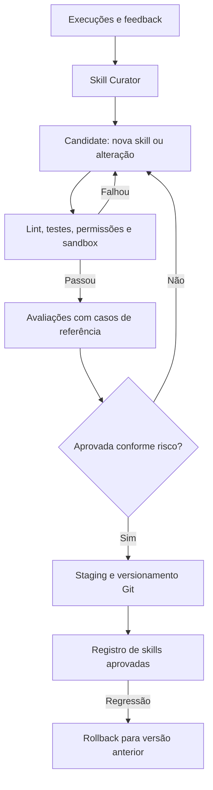

**Política de publicação:** mudanças de documentação e metadados de baixo risco podem seguir validação automatizada definida; novas ferramentas, scripts executáveis, permissões ou alterações capazes de escrever/excluir dados precisam de aprovação humana. O motor nunca publica seu próprio código automaticamente.

## 8. Melhoria contínua e separação dos tipos de aprendizado

Diferenciar: **(a)** atualização factual da memória, **(b)** melhora procedural de skills, **(c)** avaliação/melhoria de política de roteamento e **(d)** alteração do software. A categoria (d) exige fluxo normal de desenvolvimento (pull request, CI e revisão), não uma ferramenta de autoedição.

**D09 — Pipeline assíncrono completo.**

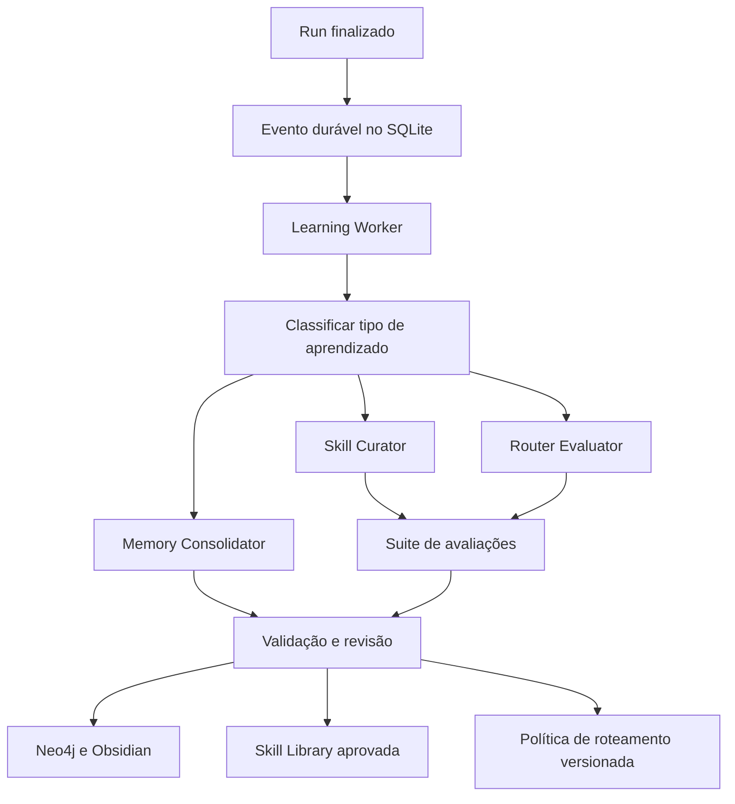

A execução da tarefa do usuário **não aguarda** a curadoria da skill ou a indexação do grafo. O worker opera com filas, limites e retentativas. A origem de todo fato extraído deve referenciar sessão, mensagem ou documento e conter nível de confiança e data.

### 8.1 Avaliação por evidências

- **Memória:** fonte existente? fato duplicado? contradição? permissão de escrita? confirmação necessária?
- **Skill:** resolveu a tarefa em fixtures? gerou artefatos válidos? aumentou custo/latência? regrediu em casos anteriores?
- **Router:** acurácia por classe, qualidade final, custo total, escalonamentos, cache, latência, erro por modelo e desvio do baseline.
- **Feedback humano:** correção explícita e avaliações são sinais de qualidade, mas não autorizam executar operações sensíveis retroativamente.

## 9. Persistência e arquitetura de memória

**Separação de responsabilidades:**

- **SQLite:** fonte de verdade para sessões, mensagens, runs, tools, eventos/outbox, feedback e métricas detalhadas.
- **Neo4j:** grafo de fatos, entidades e relações com proveniência; não substitui o histórico bruto.
- **Obsidian:** interface humana para notas, documentação, artefatos, relatórios e memória curada em Markdown.
- **Sistema de arquivos:** mídia, anexos e documentos originais, referenciados por IDs e hashes.
- **Git:** código, configurações não secretas e skills aprovadas; não commitar informações pessoais nem tokens.

**D10 — Camadas de memória e recuperação.**

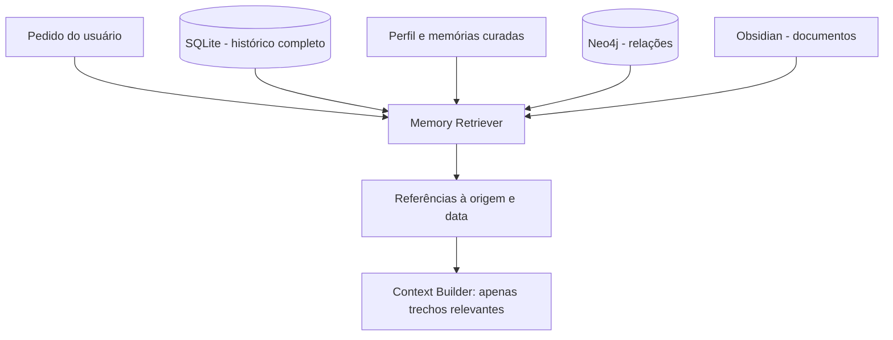

### 9.1 Namespaces lógicos de memória

| Namespace | Conteúdo | Regra |
|---|---|---|
| `session` | Mensagens, resultados de tools e resumos temporários | Não confundir com fatos permanentes |
| `user` | Preferências e compromissos do usuário | Correções e autorizações explícitas |
| `neoson` | Conhecimento operacional do assistente, lições e procedimentos | Não sobrescrever notas pessoais |
| `documents` | Conteúdo e metadados de fontes externas | Preservar original, hash e procedência |
| `graph` | Entidades e relações verificáveis | Guardar origem por aresta/fato |
| `evaluations` | Exemplos rotulados e avaliações | Não contaminar conjuntos de teste |

### 9.2 Grafo de conhecimento (modelo inicial)

Nós possíveis: `Person`, `Project`, `Document`, `Concept`, `Decision`, `Task`, `Event`, `Skill` e `Source`. Relações possíveis: `WORKS_ON`, `MENTIONS`, `DECIDED`, `DEPENDS_ON`, `DERIVED_FROM`, `RELATES_TO`, `USES_SKILL`. Toda relação factual deve incluir `source_id`, `observed_at`, `confidence` e, quando aplicável, validade temporal. IDs estáveis impedem duplicação.

### 9.3 Ingestão de documentos

**D11 — Fluxo de documentos para o vault e grafo.**

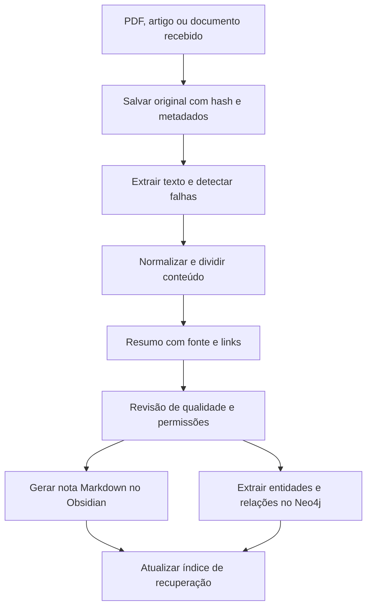

O texto extraído de documentos e páginas é **dado não confiável**, nunca instrução de sistema. Ao detectar extração incompleta, o agente registra a limitação ou repete processamento com método alternativo autorizado. O conteúdo bruto fica separado dos resumos.

## 10. Eventos, fila durável e garantias de entrega

Para o MVP, o SQLite implementará **transactional outbox**: na mesma transação que marca uma execução como concluída, o serviço inclui um evento em `outbox_events`. Um worker lê os eventos pendentes, reivindica um job com lease temporário e registra o resultado. Eventos podem ser entregues **mais de uma vez**; portanto, handlers devem ser idempotentes.

**D12 — Transação e consumo da fila.**

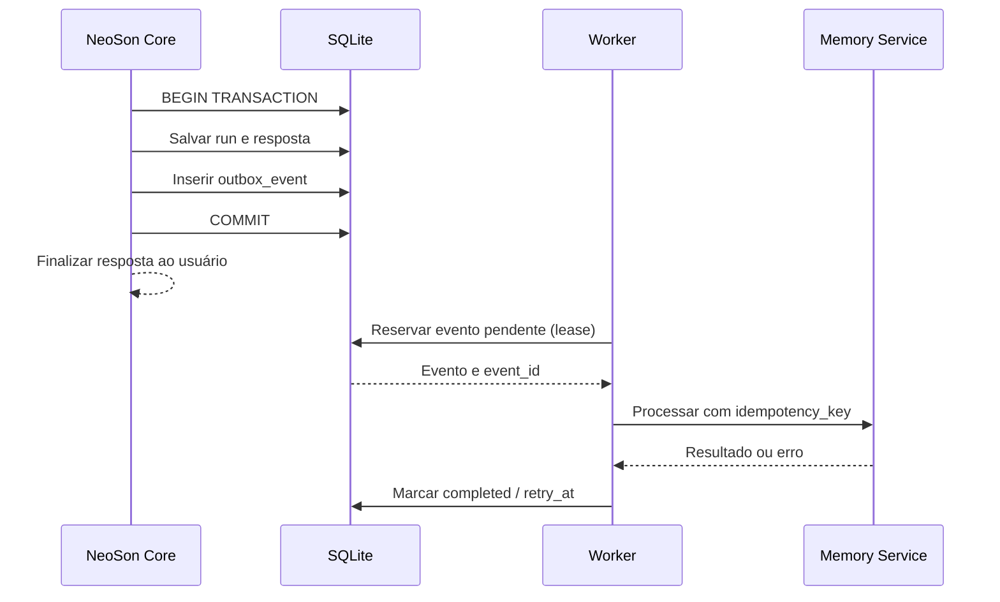

### 10.1 Modelo de eventos (contrato sugerido)

```json
{
  "event_id": "uuid",
  "event_type": "neoson.run.completed",
  "schema_version": 1,
  "occurred_at": "2026-10-19T12:00:00Z",
  "run_id": "uuid",
  "session_id": "uuid",
  "aggregate_id": "uuid",
  "correlation_id": "uuid",
  "payload": {"outcome": "success", "skill_ids": []}
}
```

Eventos iniciais: `neoson.message.received`, `neoson.run.completed`, `neoson.run.failed`, `neoson.tool.executed`, `neoson.skill.candidate_created`, `neoson.skill.approved`, `neoson.memory.review_required`, `neoson.router.eval_completed`. Para eventos que precisem acompanhar atomicamente uma alteração de domínio, inserir ambos na **mesma transação**; não enviar um evento para broker remoto antes do commit.

### 10.2 Retentativas e falhas

- `status`: `pending`, `leased`, `completed`, `dead_letter`.
- `attempts`, `retry_at`, `lease_until`, `last_error` e `worker_id`.
- Retry com backoff exponencial e jitter; limite configurável.
- **Idempotency key** por efeito externo; não repetir envio de e-mail ou criação de compromisso sem proteção de duplicidade.
- Eventos definitivamente falhos vão para inspeção e possível reprocessamento manual.

## 11. Modelo de dados e contratos

Tabelas SQLite iniciais (campos ilustrativos, sujeitos a migration):

| Tabela | Campos essenciais |
|---|---|
| `users` | `id`, `external_identity`, `role`, `created_at` |
| `sessions` | `id`, `user_id`, `channel`, `model_profile`, `state`, `updated_at` |
| `messages` | `id`, `session_id`, `role`, `content_ref`, `created_at` |
| `runs` | `id`, `session_id`, `status`, `route_version`, `started_at`, `ended_at`, `error_code` |
| `tool_calls` | `id`, `run_id`, `tool_name`, `args_redacted`, `status`, `duration_ms` |
| `usage_records` | `run_id`, `model`, `tokens_input`, `tokens_output`, `cached_tokens`, `cost_usd` |
| `skills` | `id`, `version`, `status`, `checksum`, `permissions`, `updated_at` |
| `skill_executions` | `run_id`, `skill_id`, `skill_version`, `outcome`, `score` |
| `feedback` | `id`, `run_id`, `kind`, `value`, `created_at` |
| `outbox_events` | `id`, `type`, `payload`, `status`, `attempts`, `lease_until`, `retry_at` |
| `worker_effects` | `event_id`, `handler`, `effect_key`, `completed_at` |
| `documents` | `id`, `sha256`, `source_uri`, `raw_path`, `created_at` |
| `memory_facts` | `id`, `namespace`, `value`, `source_id`, `confidence`, `status` |
| `eval_runs` | `id`, `dataset_version`, `policy_version`, `metrics_json`, `created_at` |

**Banco:** habilitar `WAL`, chaves estrangeiras, migrations versionadas e índices em `session_id`, `created_at`, `status/retry_at`; usar backups consistentes da base SQLite, nunca confiar apenas em cópia do arquivo ativo. Histórico textual pode usar SQLite FTS5; embeddings semânticos entram quando demonstrarem ganho.

### 11.1 Contratos internos mínimos

```python
class LLMProvider(Protocol):
    async def complete(self, request: LLMRequest) -> LLMResponse: ...

class Tool(Protocol):
    name: str
    async def invoke(self, arguments: dict, context: ToolContext) -> ToolResult: ...

class Router(Protocol):
    async def decide(self, request: RouteRequest) -> RouteDecision: ...

class MemoryStore(Protocol):
    async def retrieve(self, query: MemoryQuery) -> list[MemoryItem]: ...

class SkillRegistry(Protocol):
    async def find(self, query: str) -> list[SkillRef]: ...
    async def load_approved(self, skill_id: str, version: str) -> Skill: ...
```

O `engine.py` depende apenas desses protocolos, não de bibliotecas externas. Testes substituem os adaptadores por fakes determinísticos.

## 12. API do Gateway e canais

Endpoints HTTP sugeridos, autenticados e versionados:

| Endpoint | Uso |
|---|---|
| `POST /api/v1/messages` | Receber mensagem e iniciar run |
| `GET /api/v1/sessions/{id}` | Estado, histórico paginado e metadados permitidos |
| `GET /api/v1/runs/{id}` | Estado e resultado de execução |
| `POST /api/v1/approvals/{id}/decision` | Aprovar/negar ação pendente |
| `GET /api/v1/health/live` | Processo está ativo |
| `GET /api/v1/health/ready` | Dependências mínimas disponíveis |
| `GET /api/v1/metrics/summary` | Agregados autorizados para UI/exportador |

Para chat em tempo real, WebSocket/SSE é uma evolução, não condição do MVP. O cliente Raspberry deve reconectar com backoff; envio de comandos precisa de autenticação e proteção contra reprodução. Telegram associa o identificador do remetente a uma lista de permissões, não apenas ao nome visível.

### 12.1 Voz e estados do NeoSon Robot

**D13 — Pipeline de voz (decisão de STT/TTS configurável).**

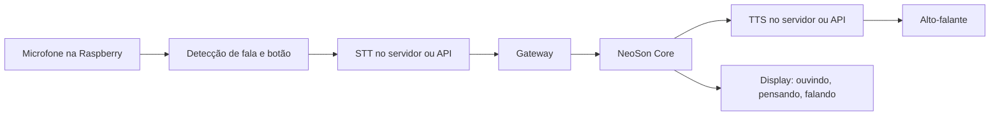

Estados da interface: `idle`, `listening`, `transcribing`, `thinking`, `using_tool`, `speaking`, `error`, `offline`. Esses estados refletem eventos do servidor e não revelam informações sensíveis na tela. Evitar transmitir áudio continuamente sem uma ação de ativação e indicação clara de captura.

## 13. Obsidian como NeoSon Control Center

O Obsidian é o **painel de acompanhamento e a base de conhecimento navegável**. O `Metrics Exporter` executa no notebook e gera notas Markdown com YAML frontmatter. Bases pode estruturar tabelas e cartões; Dataview e plugins de gráficos são opcionais e devem ser validados conforme versão/segurança. Para métricas de segundo a segundo e alertas críticos, uma solução dedicada seria complementar no futuro.

**D14 — Pipeline de métricas para o Obsidian.**

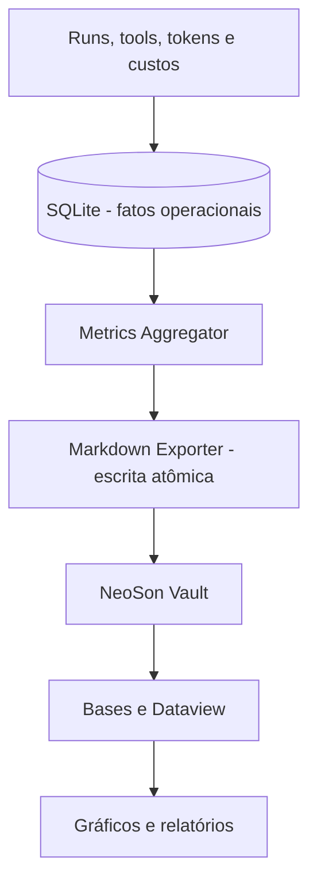

### 13.1 Dashboards previstos

| Dashboard | Indicadores | Fonte |
|---|---|---|
| `Home` | visão geral, últimos jobs e avisos | resumos diários |
| `LLM & Custos` | tokens, cache, custo, baseline, custo por tarefa | `usage_records` |
| `Router Lab` | acurácia, confusion matrix, escalonamento, versão da política | `eval_runs` |
| `Skills & Learning` | propostas, aprovadas, regressões, versões e eficácia | `skills`, `skill_executions` |
| `Memory Intelligence` | fatos, fontes, contradições e revisões | `memory_facts`, eventos |
| `NeoSon System` | falhas, fila, jobs atrasados, capacidade | outbox, health checks |

### 13.2 Estrutura do vault

```text
NeoSon-Vault/
├── Dashboard/
│   ├── Home.md
│   ├── LLM-Custos.md
│   ├── Router-Lab.md
│   ├── Skills-Learning.md
│   ├── Memory-Intelligence.md
│   └── NeoSon-System.md
├── Metricas/
│   ├── Diarias/
│   ├── Modelos/
│   ├── Experimentos/
│   └── Avaliacoes/
├── Skills/
│   ├── Ativas/
│   └── Propostas/
├── Memoria/
│   ├── Usuario/
│   └── NeoSon/
├── Conhecimento/
│   ├── Artigos/
│   ├── Projetos/
│   └── Documentos/
└── Revisao/
```

Exemplo de nota agregada:

```yaml
---
tipo: neoson-metricas
data: 2026-10-19
execucoes_total: 125
sucesso_pct: 94.2
custo_usd: 0.63
economia_pct: 36.8
baseline_id: advanced-model-all-tasks-v1
skills_propostas: 2
---
```

**Os números acima são fictícios, somente para demonstrar o schema.** Exportar sumários, não cada trace detalhado; limitar cardinalidade, usar nomes de arquivos estáveis e escrita atômica (`arquivo.tmp` → rename). Não exportar prompts brutos, credenciais ou dados privados sem decisão explícita.

## 14. Segurança, privacidade e ações externas

**D15 — Fluxo de autorização de ferramenta.**

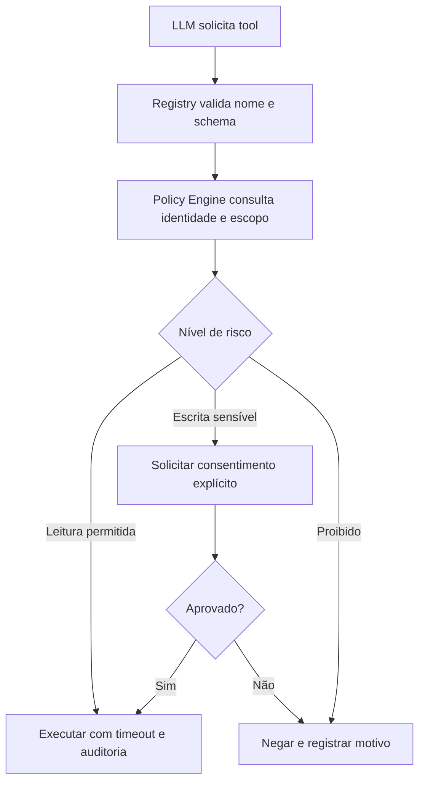

Regras mínimas:

- Segredos somente em armazenamento protegido ou variáveis de ambiente, nunca no Git nem no vault exportado.
- Usar OAuth com escopos mínimos para e-mail e calendário; separar **ler**, **criar rascunho** e **enviar/excluir**.
- Confirmar operações sensíveis: envio de e-mail, exclusão, alteração de agenda, escrita fora da área autorizada, execução destrutiva de shell e publicação de código/skill executável.
- Ferramentas com parâmetros validados por schema; proibir caminhos arbitrários fora de diretórios permitidos.
- Tratar páginas web, PDFs e e-mails como **dados potencialmente maliciosos** (prompt injection); nunca conceder a eles autoridade para alterar regras.
- Redigir dados sensíveis em logs; definir retenção e backup cifrado quando houver dados pessoais.
- Toda aprovação expira, relaciona-se a uma ação concreta e não pode ser reutilizada para outro argumento.
- Worker de aprendizagem deve funcionar com privilégios ainda mais restritos do que o fluxo interativo.

## 15. Observabilidade, economia e avaliação

Uma única execução deve produzir uma trilha verificável: gateway → decisão de roteamento → recuperação de memória → prompt/modelo → chamadas de tools/subagentes → resposta → evento assíncrono → atualizações de memória/skill. Correlacionar por `trace_id` e `run_id`.

### 15.1 Métricas e definições

| Métrica | Definição operacional |
|---|---|
| `task_success_rate` | tarefas que passam em critérios definidos / tarefas avaliadas |
| `routing_accuracy` | classificação correta segundo conjunto rotulado / casos avaliados |
| `cost_per_success` | custo total das execuções / tarefas aprovadas |
| `estimated_savings_pct` | `(custo_baseline - custo_rota) / custo_baseline * 100` |
| `cache_hit_ratio` | tokens de entrada reportados como cacheados / tokens de entrada elegíveis |
| `escalation_rate` | execuções que precisaram de modelo mais avançado / execuções roteadas |
| `skill_regression_rate` | casos anteriormente aprovados que falham após nova versão |
| `worker_lag_seconds` | atraso entre criação e início do processamento do evento |
| `outbox_dead_letter_count` | eventos que esgotaram tentativas |

**Cuidado:** economia só é válida quando baseline e política usam o mesmo conjunto de tarefas, mesmas regras de qualidade e preços/condições compatíveis. Calcular custo de todas as chamadas, inclusive classificador, retries, subagentes, cache e avaliações quando aplicável.

### 15.2 Laboratório de roteamento

**D16 — Experimento e promoção de política.**

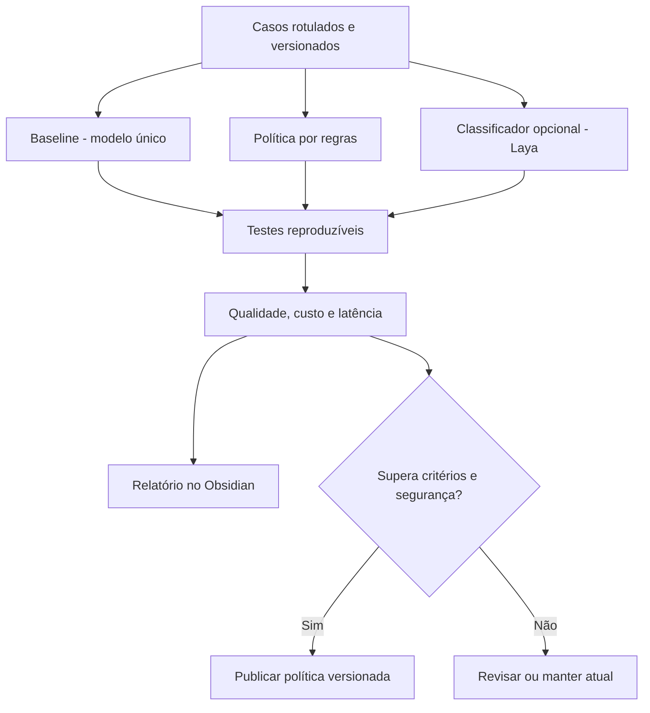

Dataset sugerido: conversas simples, ferramentas, recuperação de memória, tarefas complexas, ambiguidade, falhas, permissão/negação e adversariais. Separar `train`, `validation` e `test`; não treinar com os exemplos de teste. A Laya é candidata experimental, não dependência estrutural.

## 16. Desenvolvimento, CI/CD e qualidade de código

**Ferramentas sugeridas:** Python 3.12+ (compatibilidade do hardware/dependências a confirmar), `uv` ou `pip`, `ruff`, `mypy`, `pytest`, `pytest-asyncio`, `coverage`, `pre-commit`, GitHub Actions e Docker Compose para serviços auxiliares. Escolher versões exatas na implementação e fixá-las em lockfile.

**D17 — Fluxo de mudança e entrega.**


### 16.1 Pirâmide de testes

1. **Unitários:** roteador, orçamento, Context Builder, parsing de tools, policy e estados do loop (LLM fake).
2. **Contrato:** adapters de LLM, ferramentas, banco e exportador; schemas de eventos versionados.
3. **Integração:** SQLite + worker; interrupção/reinício; calendar sandbox; skills com fixtures.
4. **E2E:** Telegram → Gateway → resposta; Pi simulada → gateway; documento → vault; aprovação → tool.
5. **Avaliação de IA:** qualidade do resultado, custo, seleção de modelos, skills com versões e testes de prompt injection.

### 16.2 Critérios de pronto por feature

Código tipado, logs correlacionáveis, configuração documentada, testes automatizados, tratamento de falhas, permissões revisadas e procedimento de rollback quando houver mudança persistente.

## 17. Estrutura recomendada do repositório

```text
neoson/
├── apps/
│   ├── gateway/
│   ├── robot/
│   ├── worker/
│   └── dashboard/
├── src/neoson/
│   ├── core/
│   │   ├── engine.py
│   │   ├── context.py
│   │   ├── session.py
│   │   ├── policy.py
│   │   └── delegation.py
│   ├── routing/
│   │   ├── router.py
│   │   └── model_selector.py
│   ├── providers/
│   ├── tools/
│   ├── skills/
│   │   ├── loader.py
│   │   ├── registry.py
│   │   └── validator.py
│   ├── memory/
│   │   ├── session_store.py
│   │   ├── knowledge_graph.py
│   │   ├── vault.py
│   │   └── consolidation.py
│   ├── learning/
│   │   ├── skill_curator.py
│   │   ├── router_evaluator.py
│   │   └── feedback.py
│   ├── infrastructure/
│   │   ├── events.py
│   │   ├── outbox.py
│   │   └── scheduler.py
│   └── telemetry/
├── skill_library/
├── tests/
│   ├── unit/
│   ├── integration/
│   ├── e2e/
│   └── evaluations/
├── migrations/
├── configs/
├── docs/
│   ├── architecture/
│   ├── decisions/
│   └── runbooks/
├── experiments/
├── deployment/
│   ├── docker-compose.yml
│   └── systemd/
├── pyproject.toml
├── .env.example
└── README.md
```

## 18. Configuração, disponibilidade e operação

Configurações iniciais propostas:

```dotenv
NEOSON_ENV=development
NEOSON_LOG_LEVEL=INFO
NEOSON_DB_PATH=./data/neoson.db
NEOSON_VAULT_PATH=./data/NeoSon-Vault
NEOSON_PRIMARY_MODEL_PROFILE=balanced
NEOSON_ROUTER_POLICY=rules-v1
NEOSON_MAX_AGENT_STEPS=12
NEOSON_MAX_SUBAGENTS=2
NEOSON_APPROVAL_MODE=required_for_sensitive
NEOSON_MEMORY_GRAPH_ENABLED=false
NEOSON_METRICS_EXPORT_ENABLED=true
```

**Operação:** processo gateway e worker independentes, reinício via `systemd` ou Compose, health checks, logs estruturados em JSON, rodízio de logs, limites de RAM, timeouts e circuit breaker nos provedores. Não depender do PC pessoal ligado. Expor o gateway somente em rede confiável/VPN ou com autenticação e TLS adequados; nunca abrir APIs locais diretamente na internet sem proteção.

**Backup e restauração:** SQLite com backup consistente, vault com snapshots/versionamento, anexos originais, manifests de skills, configs sem segredos, mais recuperação segura de credenciais. Testar restauração em diretório temporário e verificar integridade e correspondência dos links do vault.

## 19. Roadmap de implementação e critérios de aceite

| Fase | Entregas mínimas | Critério de aceite |
|---|---|---|
| **F0 — Fundação** | repositório, `pyproject`, CI, tipagem, documentação, configs e ADRs | `pytest`, `ruff` e `mypy` no CI |
| **F1 — Core MVP** | Gateway CLI/Telegram, SQLite, LLM Adapter, loop, registry, policy e outbox | conversa, tool fake e reinício sem perda de evento |
| **F2 — Memória e Obsidian** | busca FTS5, memória curada, vault, métricas Markdown | recuperar decisão anterior com fonte; dashboard diário |
| **F3 — Skills** | loader, catálogo, metadados, fixtures e versões | executar skill aprovada e medir resultado |
| **F4 — Learning Engine** | workers, propostas, testes, aprovação e rollback | propor v1.1 sem publicar código automaticamente |
| **F5 — Router Lab** | regras, dataset, benchmark, custo/cache, Laya opcional | comparar baseline e publicar somente política validada |
| **F6 — Robot + integrações** | áudio, display, calendário/e-mail e subagentes | jornada voz → autorização → ação → feedback |
| **F7 — Grafo e expansão** | Neo4j, fatos com proveniência, recuperação híbrida | comparar ganho de qualidade com/sem grafo |

### 19.1 Primeiro incremento recomendado (vertical slice)

**D18 — A primeira entrega funcional de ponta a ponta.**

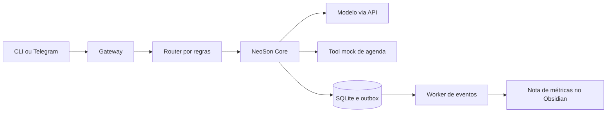

**Cenário de demonstração:** usuário pergunta sobre compromisso; roteador escolhe perfil; LLM pede `calendar_list`; policy permite leitura; tool fake retorna agenda; LLM responde; sessão e evento são salvos na mesma transação; worker exporta registro diário ao vault. Depois substituir o fake pela integração real com autorização.

### 19.2 Backlog inicial de tarefas

| ID | Tarefa | Dependência |
|---|---|---|
| T-001 | Definir ADR-001 monólito modular e limites dos módulos | — |
| T-002 | Criar `RunContext`, `Message`, `ToolCall`, `ToolResult`, `RouteDecision` | T-001 |
| T-003 | Criar `LLMProvider` fake e adaptador real mínimo | T-002 |
| T-004 | Implementar Agent Loop com limite de passos | T-003 |
| T-005 | SQLite migrations para sessão/run/outbox | T-002 |
| T-006 | Tool Registry, tool fake e Policy Engine | T-004 |
| T-007 | Gateway CLI e Telegram com autenticação | T-004, T-005 |
| T-008 | Worker outbox com lease, retry e idempotência | T-005 |
| T-009 | Metrics Exporter Markdown e dashboard Home | T-008 |
| T-010 | Recuperação de histórico FTS5 e resumo | T-005 |
| T-011 | Catálogo e loader de SKILL.md com versionamento | T-004 |
| T-012 | Suite de avaliação inicial do roteador | T-004 |

## 20. Riscos, trade-offs e questões em aberto

| Risco / decisão | Tratamento proposto |
|---|---|
| Notebook com 16 GB executar serviços demais | iniciar leve; adicionar Neo4j e observabilidade pesada após medição |
| Alto custo com modelos e subagentes | perfis, budgets, cache, limites e relatório de custo por sucesso |
| Roteador errar classificação | fallback seguro, métricas, revisões e testes adversariais |
| Memória incorporar fato incorreto | proveniência, estado pendente, contradições e revisão |
| Skill injetar instruções ou executar script indevido | registro aprovado, sandbox e policy por ferramenta |
| Evento duplicado criar ação duplicada | idempotency keys e confirmação de efeitos externos |
| Sincronização Obsidian conflitar arquivos | único writer por pasta gerada; sync separado; escrita atômica |
| Exposição de informações privadas em dashboards | métricas agregadas, redaction e separação de vaults quando preciso |
| API de LLM ficar indisponível | retry limitado, circuit breaker, fallback explícito e degradação graciosa |
| Plugin comunitário do Obsidian quebrar | Markdown/YAML como formato canônico; plugin somente visualização |

**Pontos a decidir no início da implementação (não bloqueiam a arquitetura):** provedor principal de LLM; modelo de STT/TTS; canal primário da versão MVP; detalhes de autenticação do cliente Pi; estratégia de sincronização do vault; esquema definitivo de aprovações; frequência do worker/exportador; política de retenção e backup.

## 21. Definição de sucesso do primeiro MVP

O primeiro MVP está concluído quando:

1. Uma mensagem enviada no CLI ou Telegram inicia uma execução identificável.
2. O roteador escolhe uma política, sem acoplar o motor à Laya.
3. A LLM pode responder ou solicitar uma ferramenta validada pela Policy Engine.
4. A sessão, a resposta e um evento de conclusão sobrevivem a reinício do processo.
5. O worker processa o evento com mecanismo de retry/idempotência.
6. O Obsidian exibe um relatório Markdown de execuções e custo com origem verificável.
7. O pipeline CI executa `pytest`, `mypy` e `ruff` e os testes críticos passam.
8. Existe um procedimento documentado de restore do SQLite e do vault.

## 22. Glossário rápido

- **Agent Loop:** ciclo que envia contexto à LLM, interpreta ferramentas e continua até uma resposta final ou limite.
- **Tool Registry:** catálogo de ferramentas com schema, permissões e execução controlada.
- **Skill:** procedimento reutilizável e versionado, geralmente descrito em `SKILL.md`.
- **Subagente:** execução independente com contexto menor, ferramentas e orçamento controlados.
- **Router:** política que classifica o pedido e recomenda execução/modelo; não substitui o Agent Loop.
- **Cache de contexto:** reutilização temporária de tokens conforme condições do provedor; não é memória persistente.
- **Transactional Outbox:** evento armazenado atomicamente junto ao estado de negócio, consumido depois.
- **Idempotência:** capacidade de receber o mesmo evento duas vezes sem duplicar seu efeito.
- **Vault:** diretório de notas e anexos Markdown usado pelo Obsidian.
- **Trace:** registro correlacionado das etapas de uma execução.
- **Baseline:** configuração de referência para comparar qualidade, preço e tempo.

## 23. Referências conceituais e próximos artefatos

A arquitetura foi consolidada a partir das decisões discutidas sobre **NeoSon**, e de conceitos de Agent Loop, skills e subagentes estudados no Hermes Agent, memória inspirada em Honcho, roteamento especializado discutido com a Laya, grafos no Neo4j e dashboards no Obsidian. Não há dependência obrigatória dessas implementações, exceto das tecnologias escolhidas por decisão do projeto.

Artefatos seguintes recomendados: `ADR-001-Arquitetura.md`, `ADR-002-Persistencia.md`, `ADR-003-Seguranca-Tools.md`, `API-Contracts.yaml`, `Database-Schema.sql`, `Evaluation-Dataset.jsonl`, `Skill-Spec.md` e um **skeleton** Python da Fase F0/F1.

---

**Fim da especificação NeoSon v1.0.** Diagramas Mermaid estão no próprio Markdown e podem ser mantidos como código-fonte no repositório e no Obsidian. Na versão DOCX, são apresentados como figuras, com este arquivo Markdown permanecendo como fonte editável.
