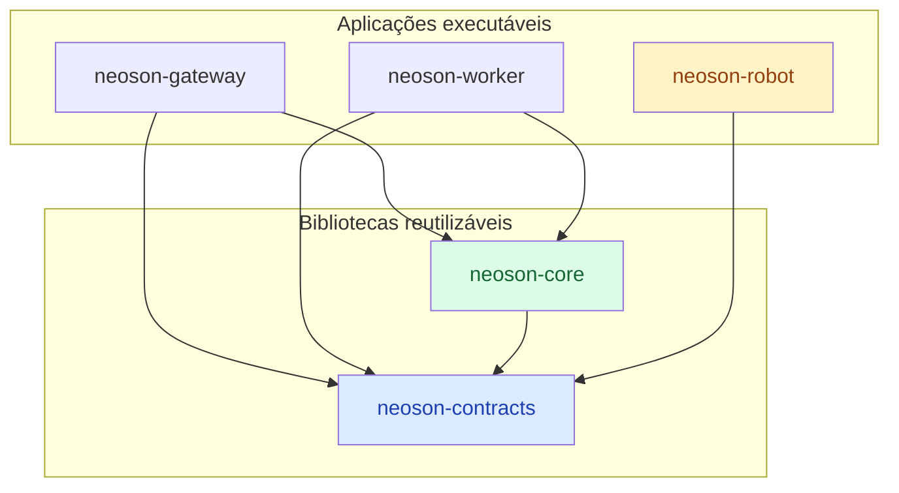

# ADR-001 — Monólito modular e limites dos módulos

- **Status:** accepted
- **Data:** 2026-10-19
- **Referências:** especificação técnica v1.0, §1.2, §1.3, §2, §3.1, §4, §11.1 e §17;
  [ADR-004](ADR-004-Packaging.md), [ADR-005](ADR-005-API-Contracts.md),
  [ADR-006](ADR-006-Import-Boundaries.md)

## Contexto

O NeoSon precisa de vários processos: gateway e worker no notebook servidor e o cliente de voz e
display na Raspberry Pi. Também precisa de componentes substituíveis: provedor de LLM, STT/TTS,
ferramentas, memória e roteador. É um projeto pessoal, mantido por uma pessoa, rodando num notebook
com 16 GB e numa Pi 5 com 8 GB.

A especificação já fixa alguns limites:

- núcleo Python próprio, sem Hermes Agent como dependência (§1.3);
- nada de microsserviços, Kafka, Redis ou Kubernetes sem necessidade comprovada (§1.2);
- nenhuma lógica de negócio em handlers HTTP, Telegram ou GPIO, e todo acesso a rede, dados e APIs
  por adaptadores testáveis (§2);
- o motor depende só de protocolos, e os testes trocam adaptadores por fakes (§11.1).

A Pi não deve instalar o que só o servidor usa (Neo4j, roteamento de LLMs, processamento de
documentos, FastAPI). Ela só precisa falar com o gateway e controlar os próprios dispositivos.

## Alternativas consideradas

| Alternativa | Por que não |
|---|---|
| Microsserviços, um por componente | Deploy, rede e observabilidade distribuída custam caro demais para um mantenedor e 16 GB; excluído pela §1.2 |
| Monólito sem fronteiras internas | Acopla SDKs de fornecedores ao loop, impede testar com fakes e dificulta trocar LLM, memória ou roteador |
| Framework de agentes externo como núcleo | Contraria a decisão de núcleo próprio (§1.3) |
| Pacote único `neoson` com fronteiras só por convenção | A Pi instalaria as dependências do servidor, e nada impediria o cliente de importar o motor |

## Decisão

Um repositório, organizado como uv workspace com poucos pacotes instaláveis
([ADR-004](ADR-004-Packaging.md)). Esta estrutura substitui a árvore `src/neoson/` da §17.

| Pacote | Tipo | Onde roda | Responsabilidade | Depende de |
|---|---|---|---|---|
| `neoson-contracts` | biblioteca | servidor e Pi | Schemas de transporte compartilhados: API HTTP v1 e eventos do robô ([ADR-005](ADR-005-API-Contracts.md)) | Pydantic |
| `neoson-core` | biblioteca | servidor | Motor do NeoSon e seus adaptadores | `neoson-contracts` |
| `neoson-gateway` | app | servidor | Handlers HTTP (FastAPI) e Telegram: autenticam, normalizam e chamam o motor | `neoson-core`, `neoson-contracts` |
| `neoson-worker` | app | servidor | Consome a outbox: aprendizagem, memória e Metrics Exporter | `neoson-core`, `neoson-contracts` |
| `neoson-robot` | app | Pi | Voz, display e dispositivos; fala com o gateway só por HTTP | `neoson-contracts` |

### Regras entre pacotes

1. `neoson-contracts` não importa nenhum outro pacote do NeoSon.
2. `neoson-core` não importa nenhum app.
3. Os apps não importam uns aos outros.
4. `neoson-robot` não importa `neoson-core`.
5. `neoson-core` não conhece FastAPI, Telegram nem GPIO; essas bibliotecas ficam nos apps.

O [ADR-006](ADR-006-Import-Boundaries.md) transforma essas regras em verificação automática.

### Módulos internos do `neoson-core`

Os componentes da §3.1 ficam como módulos Python dentro do `neoson-core`, sem `pyproject.toml`
próprio. Cada módulo é criado quando a primeira tarefa precisar dele.

| Módulo | Responsabilidade | Componentes da §3.1 |
|---|---|---|
| `engine` | Tipos de domínio (`RunContext`, `Message`, `ToolCall`, `ToolResult`, `RouteDecision`), estados da execução, Agent Loop, Context Builder, Policy Engine, delegação a subagentes e as portas (`typing.Protocol`) que o motor consome | NeoSon Core, Context Builder, Policy Engine, Subagent Manager |
| `routing` | Políticas de roteamento (regras primeiro) e seleção de modelo | Router |
| `providers` | Adaptadores de LLM e, depois, de STT e TTS. Único lugar com SDKs de fornecedores de modelo | LLM Adapter |
| `tools` | Tool Registry e adaptadores de ferramentas (agenda, e-mail, web, MCP) | Tool Registry |
| `skills` | Loader, catálogo e validação das `SKILL.md` versionadas | Skill Registry e Loader |
| `memory` | Histórico de sessões, memória curada, vault, grafo (opcional) e consolidação | Memory Service |
| `learning` | Propostas de skills, avaliação do roteador e feedback; executado pelo worker | Learning Workers |
| `infrastructure` | SQLite (conexão, migrations, transações), outbox e eventos, scheduler e configuração do servidor | — |
| `telemetry` | Logs estruturados, traces, uso e custo, Metrics Exporter | Metrics Exporter |

A Policy Engine fica no `engine`, separada do Tool Registry: quem decide se uma ação pode rodar não
é quem a executa (§3.1, §5.1).

Regras internas, como intenção de projeto. Elas viram contratos do import-linter quando os módulos
tiverem código ([ADR-006](ADR-006-Import-Boundaries.md)):

1. `engine` importa só a biblioteca padrão. Não lê ambiente, arquivos nem rede, e não importa
   `neoson_contracts`: os apps traduzem os modelos de transporte para os tipos do motor
   ([ADR-005](ADR-005-API-Contracts.md)).
2. `telemetry` importa apenas `engine`; `infrastructure` importa `engine` e `telemetry`.
3. Os adaptadores (`routing`, `providers`, `tools`, `skills`, `memory`) importam `engine`,
   `infrastructure` e `telemetry`, e não importam uns aos outros. Quando um precisa do outro, o
   pedido passa por uma porta do `engine`, montada no app.
4. `learning` pode importar os módulos acima; nenhum módulo importa `learning`.
5. Só os apps leem configuração. Os módulos recebem valores prontos pelo construtor.

## Implicações

**Ganhos**

- O motor é testável com fakes determinísticos, sem rede nem SDKs (§11.1).
- Trocar provedor de LLM, roteador ou memória afeta só o adaptador e a montagem no app.
- A Pi instala só `neoson-robot` e `neoson-contracts`.
- Um único repositório, um `uv.lock` e um CI.

**Custos e riscos**

- Mais indireção (protocolos, tradução de contratos e montagem nos apps) do que chamar as
  bibliotecas diretamente.
- Mudanças nos tipos do `engine` ou em `neoson-contracts` atingem vários pacotes; ambos devem
  continuar pequenos e estáveis.

**Efeito no código e nas tarefas**

- O pacote `src/neoson/` é substituído pelo workspace.
- A configuração do servidor fica em `neoson_core.infrastructure.config`, lida pelo gateway e pelo
  worker. O `neoson-robot` tem configuração própria, porque não pode importar o `neoson-core`.
- Os tipos de domínio e as portas (T-002 da §19.2) ficam em `neoson_core.engine`.
