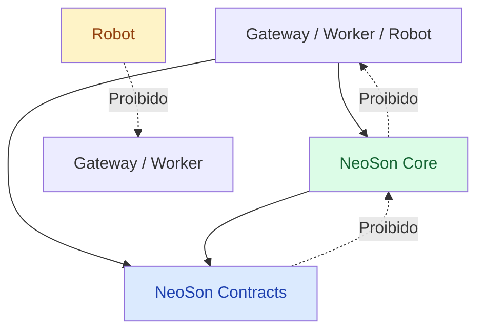
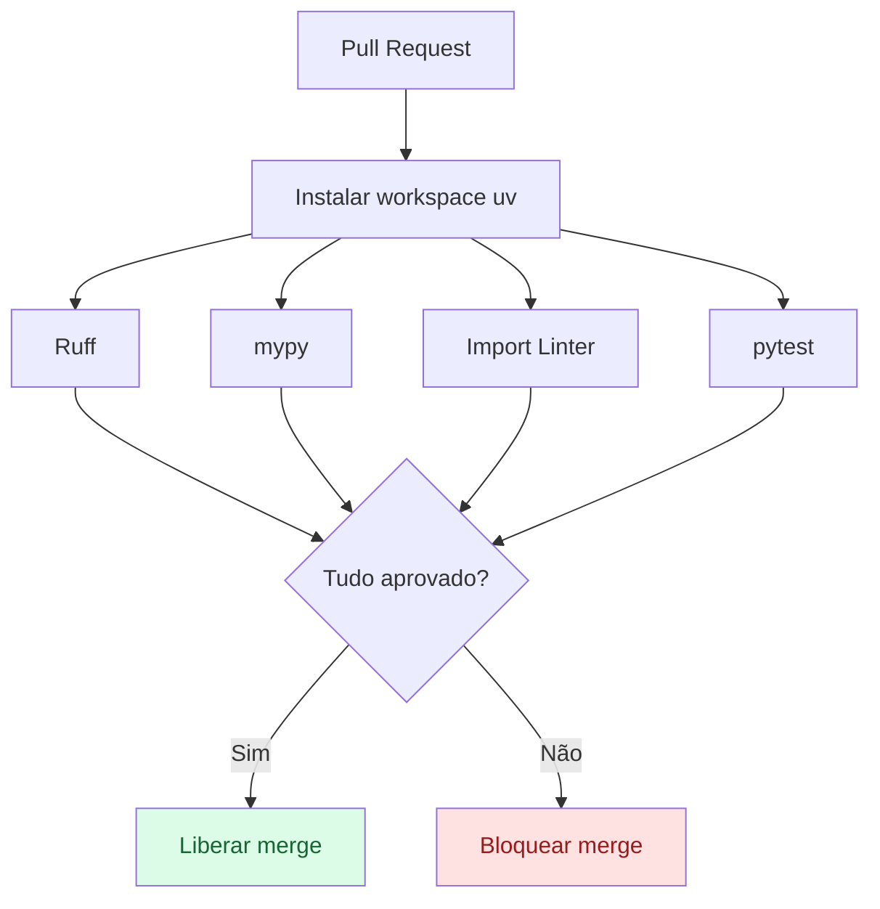

# ADR-006 — Limites de importação com Import Linter

- **Status:** accepted
- **Data:** 2026-10-19
- **Referências:** [ADR-001](ADR-001-monolito-modular.md), [ADR-004](ADR-004-Packaging.md);
  especificação técnica v1.0, §16

## Contexto

O [ADR-001](ADR-001-monolito-modular.md) define quem pode importar quem. No desenvolvimento,
`uv sync --all-packages` instala todos os pacotes juntos, então um import proibido (por exemplo, o
robô importar o motor) funcionaria na máquina e só quebraria na Pi. Revisão manual não basta.

## Alternativas consideradas

| Alternativa | Por que não |
|---|---|
| Só convenção e revisão | As fronteiras se desgastam sem verificação |
| Teste próprio que varre os imports | Reimplementa o que uma ferramenta pronta já faz, inclusive imports indiretos |

## Decisão

Usar o [Import Linter](https://import-linter.readthedocs.io/), no grupo `dev` e configurado no
`pyproject.toml` da raiz, com contratos dos tipos `layers` (direção das dependências) e `forbidden`
(imports proibidos, inclusive indiretos).

```toml
[tool.importlinter]
root_packages = [
    "neoson_contracts",
    "neoson_core",
    "neoson_gateway",
    "neoson_worker",
    "neoson_robot",
]

[[tool.importlinter.contracts]]
name = "Arquitetura em camadas"
type = "layers"
layers = [
    "neoson_gateway | neoson_worker | neoson_robot",
    "neoson_core",
    "neoson_contracts",
]

[[tool.importlinter.contracts]]
name = "Raspberry isolada do servidor"
type = "forbidden"
source_modules = ["neoson_robot"]
forbidden_modules = ["neoson_core", "neoson_gateway", "neoson_worker"]

[[tool.importlinter.contracts]]
name = "Contratos independentes"
type = "forbidden"
source_modules = ["neoson_contracts"]
forbidden_modules = ["neoson_core", "neoson_gateway", "neoson_worker", "neoson_robot"]
```

A camada de cima, com os apps separados por `|`, também impede que gateway, worker e robô importem
uns aos outros. Os pacotes entram em `root_packages` à medida que são criados.



Quando os módulos internos do `neoson-core` tiverem código, entra um segundo conjunto de contratos
com as regras internas do ADR-001 (por exemplo, o `engine` não depende de implementações concretas
de banco de dados).

### Verificações obrigatórias no CI

O GitHub Actions roda quatro verificações, e qualquer falha bloqueia o merge:

| Verificação | Ferramenta |
|---|---|
| Lint e formatação | Ruff |
| Tipos | mypy (modo estrito) |
| Limites de importação | Import Linter (`lint-imports`) |
| Comportamento, integração e contratos | pytest |



As actions do workflow são fixadas por SHA completo, como recomenda a documentação do uv.

## Implicações

- Um import proibido falha no CI antes de chegar à Pi.
- O Import Linter só vê imports Python estáticos. Ele não cobre carregamento dinâmico de plugins
  (skills), não controla a comunicação HTTP e não substitui testes de integração.
- A configuração cresce junto com os pacotes e com as regras internas do `neoson-core`.
