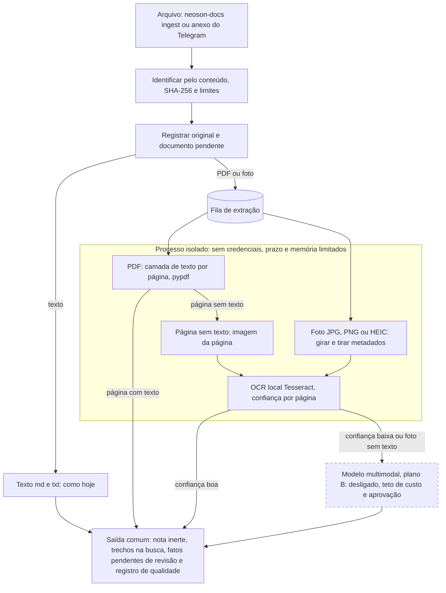

# ADR-021 — Ingestão de PDFs e imagens com extração local primeiro

- **Status:** proposed
- **Data:** 2026-11-25
- **Referências:** [ADR-019](ADR-019-Document-Ingestion.md),
  [ADR-003](ADR-003-Seguranca-Tools.md), [ADR-015](ADR-015-Graph-Extraction.md),
  [ADR-010](ADR-010-Voice.md); especificação §9.3 (D11) e §14; diagrama
  [D19](../architecture/NeoSon_Diagramas_Mermaid_v1.0/D19.mmd).

## Contexto

O `neoson-docs` aceita só `.md`, `.markdown` e `.txt` (ADR-019). O usuário decidiu
ingerir também PDFs e fotos, com um pipeline novo: extração local primeiro e um
modelo multimodal só como plano B, com teto de custo.

Os novos formatos trazem riscos que o texto não traz:

- leitores de PDF e de imagem já tiveram falhas de segurança, e arquivos pequenos
  podem se expandir em gigabytes (bombas de descompressão);
- fotos guardam no EXIF o GPS de onde foram tiradas;
- texto dentro de uma imagem pode carregar instruções ("ignore suas regras");
- o modelo multimodal tira a imagem de casa e cobra por página ou imagem.

O gateway e o banco rodam na Raspberry Pi desde 2026-11-19. O notebook com Ubuntu é o
candidato a nó de processamento, mas a topologia é decisão da F8, ainda aberta.

## Decisão

O desenho completo está no diagrama [D19](../architecture/NeoSon_Diagramas_Mermaid_v1.0/D19.mmd):

### 1. Identificação e limites

- O tipo vem do conteúdo, não da extensão: `%PDF-` é PDF; JPEG, PNG e HEIC pela
  assinatura dos primeiros bytes; texto segue as regras do ADR-019. Extensão que não
  bate com o conteúdo, tipo desconhecido, PDF cifrado ou PDF que exige senha são
  recusados com motivo fixo.
- O SHA-256 dos bytes recebidos continua sendo o ID do documento e mantém a
  ingestão idempotente. Um documento esquecido continua sem poder voltar.
- Limites configuráveis, conferidos antes de extrair (valores iniciais, a calibrar
  na implementação): PDF até 20 MB e 200 páginas; imagem até 15 MB e 40 megapixels;
  prazo por página e por documento; texto extraído dentro de
  `NEOSON_DOCUMENT_MAX_CHARS`. Documento acima de um limite é recusado inteiro, sem
  corte silencioso; o usuário pode dividi-lo.
- Fotos: o arquivo guardado em `NEOSON_DOCUMENTS_PATH` é uma cópia sem metadados de
  localização (GPS do EXIF e do XMP), feita sem recodificar quando o formato permite.
  O registro guarda o hash recebido e o da cópia. Guardar a localização exige uma
  opção explícita, desligada por padrão.

### 2. Rotas por tipo

- **Texto:** inalterada (ADR-019), síncrona.
- **PDF:** página a página, a camada de texto sai pelo `pypdf`. Página sem texto
  aproveitável segue para OCR com a imagem embutida nela (um PDF escaneado costuma
  ter uma imagem por página). Um renderizador de páginas só entra se a medição
  mostrar páginas que não se resolvem assim.
- **Foto:** decodificada pelo Pillow, girada conforme o EXIF, sem metadados, com
  limite de pixels, e enviada ao OCR.
- **OCR:** Tesseract local, em português, chamado como programa externo com prazo.
  A saída TSV dá a confiança por palavra; a da página é a média.
- **Multimodal (plano B):** só para a página ou foto em que o OCR falhou (confiança
  abaixo do limiar ou nenhum texto numa foto). Desligado por padrão. Ligado, exige
  autorização explícita por execução, respeita um teto diário em USD e pede
  aprovação quando um documento precisar de mais páginas que um limite configurável
  (inicial: 5). Pelo Telegram, a aprovação é a do
  ADR-003: ação concreta, hash dos argumentos, uso único. A imagem sai sem
  metadados e reduzida ao necessário. Custo e páginas enviadas ficam registrados.

### 3. Saída comum e qualidade

Todas as rotas terminam na saída do ADR-019: nota inerte no vault (texto dentro do
bloco de código), trechos no índice FTS5 da `memory_search` e, com o grafo ligado,
jobs de extração cujos fatos entram como `pending` até a revisão (ADR-015). O texto
extraído de PDF, OCR ou multimodal é dado, nunca instrução.

Cada documento ganha um registro de qualidade, só com números: páginas por rota
(texto, OCR, multimodal, vazias), confiança média e mínima do OCR, caracteres e
avisos fixos (por exemplo, "tabelas e colunas podem sair fora de ordem"). A nota
mostra esse resumo e a fonte de cada trecho ganha o número da página. Páginas vazias
ou de baixa confiança aparecem no registro: nunca somem em silêncio.

### 4. Isolamento do parser

A extração roda num processo filho, no mesmo molde do Piper e do Whisper (ADR-010):
recebe os bytes e os limites, devolve páginas e qualidade em JSON e não acessa o
banco, o vault ou a rede. O ambiente do filho vai sem credenciais. Prazo, memória e
CPU são limitados por limites de recurso do processo no Linux, onde o NeoSon roda; no
Windows, só o prazo vale. Estourou, o processo é encerrado e o documento fica com a
falha registrada. O Pillow roda com limite de
pixels. Do PDF, só se leem texto e imagens: JavaScript, formulários, anexos e links
são ignorados.

### 5. Entrada

- `neoson-docs ingest <arquivo>`: local e explícita, a primeira porta.
- Anexos do Telegram (documento ou foto) de usuários autorizados, com o tamanho
  conferido antes do download, entram na mesma fila. O Telegram está pausado por
  decisão do usuário; essa entrada espera a volta dele.

### 6. Fila e onde roda

A ingestão de PDF e foto se divide em duas etapas. O registro é rápido: identifica,
calcula o hash, confere limites, guarda o original e marca o documento como
pendente. A extração é lenta e vira um job com lease e novas tentativas, como os
jobs do grafo (ADR-015). Uma extração por vez.

Hoje o job roda na máquina do banco (a Pi). O OCR funciona nela, mas devagar; o
notebook é o lugar natural. Como um worker remoto acessa originais e banco é decisão
da F8. O contrato do processo filho (bytes e limites entram, páginas e qualidade
saem) é o que permite mudar o lugar sem mudar o pipeline.

### Dependências opcionais

Nada é instalado por este ADR. As tarefas de implementação adicionam:

| Dependência | Para quê | Como entra |
|---|---|---|
| `pypdf` | camada de texto e imagens das páginas | extra opcional do workspace (Python puro), como o do Neo4j |
| Pillow (+ `pillow-heif` para HEIC) | decodificar, girar, tirar metadados, limitar pixels | mesmo extra; licença do `pillow-heif` e da libheif a conferir |
| Tesseract com o idioma `por` | OCR | programa do sistema (pacotes `tesseract-ocr` e `tesseract-ocr-por`), fora do workspace |
| Modelo multimodal | plano B | API já configurada; sem dependência nova |

## Riscos e limites

| Risco | Mitigação |
|---|---|
| Falha de segurança no leitor de PDF ou imagem | processo filho sem credenciais, banco ou rede; prazo, memória e CPU limitados |
| Bomba de descompressão | limites de bytes, páginas, megapixels e memória antes e durante a extração |
| Instrução escondida no texto extraído | texto é dado: nota em bloco de código, fatos só após revisão, `memory_search` como dado |
| Localização vazar | GPS removido antes de guardar ou enviar; guardar exige opção explícita |
| Custo e privacidade do multimodal | desligado; autorização por execução, teto diário, aprovação de lotes, registro de custo |
| OCR ruim (letra à mão, foto tremida, baixa resolução) | confiança registrada por página; página fraca sinalizada na nota, não descartada |
| Tabelas e colunas embaralhadas pelo `pypdf` | aviso no registro de qualidade; sem reconstrução de tabelas |
| Pi lenta para OCR | fila com uma extração por vez; mudança para o notebook na F8 |

Limites conhecidos desta proposta: letra à mão e fórmulas não são alvo; PDF com
senha é recusado; o limiar de confiança e os limites de tamanho são iniciais e
dependem de medição com documentos do usuário.

## Alternativas consideradas

- **Multimodal para tudo:** mais simples, mas todo documento sai de casa e cada
  página custa.
- **Só `pypdf`** (a recomendação inicial da decisão): não cobre fotos nem PDFs
  escaneados, que o usuário decidiu incluir.
- **Extração no próprio processo do worker:** uma falha numa biblioteca nativa
  derrubaria o worker, que tem acesso ao banco e às credenciais.
- **Renderizar toda página** (`pdftoppm`, `pypdfium2`): dependência maior; a página
  escaneada já traz a imagem. Fica para quando a medição pedir.
- **Frameworks de documento completos:** dependências pesadas (modelos, torch) e
  comportamento opaco para um assistente pessoal.

## Consequências e implementação

O documento passa a ter tipo, estado de extração e registro de qualidade; os trechos
ganham página. Isso exige migração (extensões aceitas, colunas novas) e backup antes
de atualizar a instalação. A implementação se divide em:

1. PDFs com texto: identificação pelo conteúdo, limites, rota `pypdf`, processo
   filho, fila, registro de qualidade e migração.
2. Páginas sem texto e fotos: Pillow e HEIC, remoção de metadados, OCR com confiança
   e o plano B multimodal.
3. Anexos do Telegram, quando o Telegram voltar.

A topologia (Pi ou notebook) fica com a decisão da F8. A implementação só começa
depois de o usuário aprovar este ADR; até lá, o status é `proposed`.
