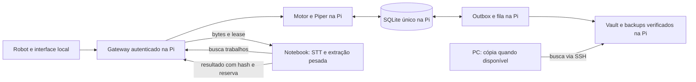

# ADR-022 — Núcleo na Raspberry Pi e notebook de processamento

- **Status:** proposed
- **Data:** 2026-11-28
- **Referências:** [ADR-002](ADR-002-Persistencia.md),
  [ADR-004](ADR-004-Packaging.md), [ADR-021](ADR-021-Multimodal-Ingestion.md).

## Contexto e proposta

Gateway, motor, banco e voz já foram implantados na Pi. O notebook está preparado
para processamento pesado; ainda não existe worker remoto. Esta proposta define
a F8 e não altera serviços, dados ou rede. WhatsApp será uma interface local na
Pi, por navegador ou app, conforme o [planejamento](../runbooks/mensagens.md).

## Responsabilidades e falhas

- A Pi mantém o banco canônico, autenticação, autorizações, filas, memória e
  síntese local. O worker da outbox deve operar nela; isso exige implantação
  separada. O notebook não monta nem abre o SQLite pela rede.
- O notebook busca jobs por API autenticada na Pi, sem abrir porta de
  processamento nele. Recebe bytes limitados e parâmetros tipados, sem comandos
  de shell, tokens de fornecedores ou caminhos arbitrários. STT local, PDF/OCR
  e modelos locais são capacidades selecionadas explicitamente.
- Claims usam lease, token de reserva e hash da fonte. Resultados atrasados,
  alterados ou de documento esquecido são recusados; uma reserva expirada pode
  ser recuperada. Queda do notebook mantém trabalhos pendentes e não consome
  tentativas de execução enquanto ele está indisponível.
- A voz mantém os provedores configurados. Troca ou fallback para nuvem exige
  configuração explícita; documentos não passam ao multimodal automaticamente.
  O núcleo deve continuar respondendo com o notebook desligado.

## Dados, riscos e reversão

O banco já está na Pi: o banco antigo do PC não deve originar outro servidor.
Antes de atualizar esquema ou serviços, parar escritores e criar backup
verificado. O vault e backups são produzidos na Pi; o PC busca cópias por SSH
para os destinos locais configurados. Se estiver desligado, a exportação espera;
os arquivos devem ser preparados em destino temporário e conferidos antes de
substituir a cópia anterior. Credenciais não entram nesses arquivos.

Disco único, falta de espaço, rede instável e segredos na Pi permanecem riscos.
Medir capacidade e fila, manter backup fora do disco de origem e restringir os
serviços à rede autorizada. Segredos ficam em ambiente protegido/keyring.
Reversão desliga o processamento remoto e retoma o worker local após expirar as
reservas antigas; mudanças de esquema exigem código e backup compatíveis.

## Implementação e validação futura

Dividir em quatro entregas: API da fila e contratos; worker do notebook;
exportação/backup pela rede; implantação e observação de uma semana. Antes de
implementá-las, aprovar esta proposta.

Validar queda e retorno do notebook, lease expirado e resultado duplicado,
fonte esquecida, rede indisponível, limite de recursos e restauração de backup
em destino descartável. O aceite operacional exige uma semana sem intervenção
manual no núcleo, com filas/erros registrados e recuperação de serviços. Essa
validação ainda não foi executada.
